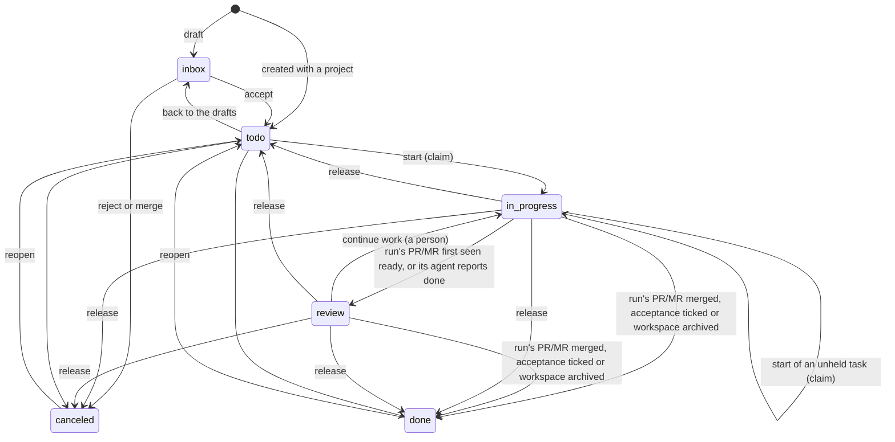

# 03 · Domain model, statuses and the plan repository

This is the data model of v1: what a space, a milestone, a feature and a task are, how they are
stored, which statuses they move through, and how they connect to Paseo projects, workspaces and
agents. Storage mechanics (sync, conflicts) are in [05-architecture.md](05-architecture.md).

## Two tiers of state

| Tier | Where | Shared | Holds | Changes |
| --- | --- | --- | --- | --- |
| **Plan** | A dedicated git repository per umbrella project ("plan repo"), e.g. `laconote-plan` | Yes, through the git remote; everyone invited to the repo sees it | Milestones, features, tasks, their briefs and acceptance checklists, coarse status, who started what, PR/MR links | On human or agent decisions: create, edit, start, review, done |
| **Runtime** | `$PASEO_HOME/plugin-data/dashboard/` on each machine | No | Which local workspace and agent run each task, live activity, last agent message, pending sync operations, local project mapping, the Laconote API key and the release context mapping | Every few seconds while agents work |

Why split: Paseo agent and workspace ids exist only on one daemon, and live activity changes far too
often to commit. Collaborators see the coarse state through the plan repo; the person whose machine
runs the agent sees the live state.

## Hierarchy

```text
Space (= plan repo, e.g. Laconote)
├── Projects: the sub-projects of the space, one per code repository (core, site, android, ios, ...)
├── Milestone (a release or a dated goal: "Release 2.3", due 2026-11-30)
│   └── Feature (cross-repo unit of the roadmap: "TOTP 2FA", one shared branch name)
│       └── Task (one repo, one branch, one workspace, one agent, one PR/MR)
│           └── Acceptance checklist (the definition of done, ticked by humans or by the agent)
└── Inbox (tasks with status `inbox`: drafts from meetings or ChatGPT, waiting for triage)
```

- **Project is a dimension, not a level.** A task belongs to exactly one project (the repo it changes);
  a feature spans several projects through its tasks. The roadmap draws projects as lines.
- **Feature phases are dependencies.** "Core first, then the clients in parallel" is
  `site.depends_on = [core task]`, `android.depends_on = [core task]`, and so on. The roadmap derives
  the phase layers from the dependency graph; there is no separate phase field.
- A task may have no feature (a small fix) and no milestone (backlog). A milestone-less feature sits
  in "Later".
- Subtasks are out of scope for v1: the acceptance checklist covers small steps, and anything
  bigger is its own task with a dependency.

## Entities

All entities share one id scheme and live in one directory per type.

### Ids

`<SPACE KEY>-<5 characters of Crockford base32>`, for example `LAC-7K3QX`. The characters come from a
random source and are checked against every id the local clone knows before use.

- **Why not sequential numbers.** With several people creating tasks on their own machines, a
  counter collides as soon as two of them create a task between syncs; renumbering afterwards breaks
  references. Random ids avoid the collision instead of repairing it. Beads moved from sequential to
  hash-based ids for the same reason, and Backlog.md ships a duplicate-id repair module for the
  problem counters cause (see [01-research.md](01-research.md)).
- **A true collision is still survivable.** Two files claiming one id are both reported in the space's
  problems, and writes to that id are refused until a person renames one; the UI offers a rename that
  rewrites every reference in the same commit. The plugin never renames on its own, because file
  names, wikilinks, runtime state and agent labels all carry the id. The loader never drops a file.
- **People refer to tasks by title.** The UI shows titles; God Mode resolves titles too (see
  [06-god-mode.md](06-god-mode.md#resolving-names)). Ids are for precision and for links.

### Files

```text
laconote-plan/
├── space.yaml
├── ROADMAP.md                       generated by the plugin, never edited by hand
├── milestones/LAC-W4N8C-release-2-3.md
├── features/LAC-2HV9D-totp-2fa.md
├── tasks/LAC-7K3QX-totp-endpoints-in-core.md
├── templates/start-prompt.md        optional: the space's own start prompt
├── views/tasks.base                 Obsidian Bases views, written once when the space is created
├── views/roadmap.base
└── .gitignore                       includes .obsidian/workspace*.json
```

- One Markdown file per entity: YAML front matter for fields, Markdown body for text.
- The file name is `<id>-<slug>.md`; the slug is an ASCII form of the title at creation (Cyrillic
  is transliterated), cut at 48 characters, and is **never** renamed afterwards. Identity is the `id`
  field, not the file name: a renamed or moved file keeps its identity.
- **Flat properties only.** Every front matter field is a text, number, date, date-time, or list of
  texts. Obsidian's properties editor and Bases work on flat properties; nested objects would show as
  unsupported there.
- **References are wikilinks to the file name.** `feature: "[[LAC-2HV9D-totp-2fa]]"` and
  `depends_on: ["[[LAC-5RT2M-totp-contract]]"]`. Obsidian then shows them as links, backlinks and graph
  edges, and Bases groups by readable names; GitHub and GitLab show the text. Because file names are
  never renamed, the links never break. The parser also accepts a bare id (`LAC-2HV9D`) and takes the
  id from the start of a link target, so hand-written references work either way.
- Unknown front matter keys and unknown body sections are preserved on rewrite, so humans, Obsidian
  and other tools can add their own.
- `ROADMAP.md` and `views/*.base` are described in [04-ux.md](04-ux.md#for-people-without-paseo).

### `space.yaml`

A plain YAML file (not a note), so nesting is fine here.

```yaml
schema: paseo-dashboard/1
key: LAC                      # id prefix, 2-6 upper-case letters, fixed after creation
name: Laconote
projects:                     # the sub-projects, in the order the roadmap draws them; keys are stable
  core:
    remote: git@gitlab-ssh.example.com:backend/core.git
    trunk: master             # base branch for new task branches
    group: Laconote           # optional umbrella; the map keeps a group's lines together (D18)
    color: "#3e8eed"          # optional line color; absent: the next palette color no project names
    web_host: gitlab.example.com   # optional: the forge's web host when the remote's host differs
  site:
    remote: git@gitlab-ssh.example.com:frontend/site.git
    trunk: master
    group: Laconote
  android:
    remote: git@github.com:acme/android.git
    trunk: main
    group: Laconote
people:                       # optional: display and matching only; grants nothing
  ergo: { name: Ergo, emails: [ergo@example.com], github: ergoTech, gitlab: { gitlab.example.com: ergo } }
labels:                       # optional: the label palette (09-forge-issues.md, Labels for tasks)
  bug: { color: "#e5484d", description: Something is broken }
  ui: { color: "#3e8eed" }
defaults:
  priority: medium
  agent_profile: Implementation   # the Paseo agent profile every start in this space uses (D14);
                                  # a task can override it; empty: each machine's own default
  mode: auto                      # the agent mode for starts whose profile names none; used only
                                  # where the provider has a mode with this id, else its default;
                                  # never a mode that skips permission prompts (Bypass, Full Access)
  human_labels: [manual]          # optional: labels marking a person's work; automatic starts pass
                                  # such a task over, a start of that one task still can (06-god-mode.md)
```

Paseo saves agent profiles per host, so the space's profile name must exist on each collaborator's
Paseo. Where it does not, the start falls back to that machine's plugin setting, then to Paseo's
default provider, and its confirmation says which profile it uses and why. People change the space's
default in the space's settings in Paseo, which writes `space.yaml` through an ordinary `set`
operation; this machine's own fallback profile is a plugin setting.

Project keys are what tasks reference. Each machine maps a project key to its own local Paseo
project by the `remote` URL (normalised: scheme, user and `.git` suffix ignored); unmatched keys are
mapped by hand on the dashboard's Projects tab, and a project this machine lacks can be cloned there
and opened in Paseo. The mapping is runtime state, not part of the repo, because paths and Paseo
project ids differ per machine.

The Projects tab writes the list (D18): adding a project (from this machine's Paseo projects, or by
URL; the trunk comes from the checkout's `origin/HEAD` or from `git ls-remote`, and the color is the
first palette color no line uses), changing its color, group or trunk, moving it up or down, and
removing it. Before any of these it writes the default color of every other line that has none, in
the same commit, so defaults never shift with the order or with a color someone picks. Each is one journaled `project` or `project_order` operation that edits `space.yaml`
through the YAML tree, so comments and unknown keys stay. A project with open tasks cannot be
removed; two projects cannot share one repository; keys are lower-case and never change. Only
`https`, `ssh`, `git`, `file` and `user@host:path` remotes are accepted or handed to git, because
every collaborator of the plan repository can write `space.yaml`.

`web_host` is the host issue and PR/MR links of the project are on, when its remote uses another
one: a self-hosted GitLab is cloned from `gitlab-ssh.example.com` and serves `gitlab.example.com`
(09-forge-issues.md, Specifics of the self-hosted GitLab). Absent, the remote's host applies. It
decides whether a task's issue is in the project's own repository (the closing keyword `Closes #N`)
and which repository the inbox import lists; the Projects tab sets it. Anything but a host name reads
as absent.

`people` maps a key (what a task's `assignee` holds) to a name, the git emails the person commits
with, a GitHub login and GitLab logins per host (there are several GitLab instances). It is for
display and matching only: "Mine" on the Tasks and Inbox tabs (and God Mode's `mine`) is the person
whose emails hold this machine's `git config user.email`, and the Laconote import assigns a draft to
the person whose name its action item's owner gives. Listing someone grants nothing; access stays
access to the plan repository.

`labels` is the palette: name → color (`#rrggbb`) and description. A task may carry any label. One
typed in the dashboard or through God Mode that the palette lacks is added to it in the same commit
with the first palette color no label uses (the line colors' palette); one written into a task file
by hand without a definition stays on the task, shows in a neutral color and is listed among the
space's problems, never dropped. Labels are named case-insensitively and written as the palette
spells them. The People & labels tab edits both, one `person` or `label_def` operation per change; a
label some task carries and a person with open tasks cannot be removed. Short forms written by hand
read too (`labels: [bug, ui]`, `bug: "#e5484d"`, `ergo: Ergo`); an edit rewrites an entry in the full
form, and a section written as a list is left for a person to turn into a map.

### Milestone

```markdown
---
id: LAC-W4N8C
type: milestone
title: Release 2.3
status: active          # planned | active | done | canceled
start: 2026-11-02       # optional
due: 2026-11-30         # optional target date
order: 30               # optional: position among milestones without dates
created: 2026-10-25T19:02:11Z
updated: 2026-10-25T19:02:11Z
---

Goals of the release, scope notes, links.
```

### Feature

```markdown
---
id: LAC-2HV9D
type: feature
title: TOTP two-factor authentication
status: active          # planned | active | done | canceled
milestone: "[[LAC-W4N8C-release-2-3]]"   # optional
branch: feat/totp-2fa   # shared branch name for every task of the feature
projects: [core, site, android, ios, backoffice]   # optional: the planned spread, used to scaffold tasks
spec: https://gitlab.example.com/backend/core/-/blob/master/docs/specs/totp-2fa/README.md   # optional
order: 10               # optional: position inside its milestone
created: 2026-10-25T19:05:40Z
updated: 2026-10-25T19:05:40Z
---

What the feature is for, the contract summary, decisions.
```

### Task

```markdown
---
id: LAC-7K3QX
type: task
title: TOTP endpoints in core
status: in_progress     # inbox | todo | in_progress | review | done | canceled
project: core           # key from space.yaml; may be empty only in `inbox`; fixed once a run claimed the task (D19)
feature: "[[LAC-2HV9D-totp-2fa]]"     # optional
milestone:              # optional; when empty, the feature's milestone applies
priority: high          # urgent | high | medium | low
rank: 2000              # optional: its place among the tasks of its priority waiting to start (D21); set by moves
assignee: ergo          # optional person key from space.yaml `people`
labels: [backend, bug]  # optional; flat for Obsidian (not `tags`, whose values cannot hold spaces)
depends_on: ["[[LAC-5RT2M-totp-contract-in-docs-api]]"]
branch:                 # optional override; see "Branch names" below
base:                   # optional override of the project's trunk
agent_profile:          # optional launch override: a profile name of the host; `update_task` sets it, only a name the host has
meeting: https://laconote.com/meeting/0d4c...7e                   # provenance of a draft: <web URL>/meeting/<id>
meeting_title: Weekly sync, 24 Oct
issue: https://gitlab.example.com/backend/core/-/issues/31   # optional: the forge issue the task stands for
links: []               # any other URLs; a claim moves the previous run's run_pr here
duplicate_of:           # set on a draft merged into another task: "[[LAC-...]]"
run_id: r-5h2k9q        # written by the claim; the current or last run
run_by: ergo
run_host: ergo-mbp
run_branch: feat/totp-2fa
run_started: 2026-10-25T21:14:03Z
run_pr: https://gitlab.example.com/backend/core/-/merge_requests/412   # this run's own PR/MR (see "Statuses")
run_review_at:          # when the run last moved the task to review (Live lists the longest waiting first)
run_ended:              # set when the run ends (merge or release); the next claim replaces all run_* fields
progress_done: 3        # written from the current run's agent reports; reset by a claim
progress_total: 5
progress_note: Enroll and verify endpoints done; recovery codes next.
progress_at: 2026-10-25T21:52:40Z
archived:               # done or canceled tasks only: when a person took it off the board (see "Archive")
requires:               # optional: what it waits for besides tasks (see "Requirements"); update_task replaces the list
  - { kind: owner, reason: pick the grace period, checked: 2026-11-20 }
readiness_checked:      # optional: the day a person last checked it can start as it is
readiness_note:         # what they found
delivery:               # optional: the way from merged code to accepted work (see "Delivery")
  stage_sha: 5e1f0c4
  stage_url: https://stage.example.com
  flags: [signal_v2]
  flags_ready: true
  device: iPhone 14 Pro
  device_ready: false
  trello: https://trello.com/c/AbCd1234
  trello_state: In QA
  qa: pending           # pending | passed | failed
  variants: [phone, wear]       # an app: the builds QA needs; environment defaults to staging
  builds: [{variant: phone, environment: staging, sha: 5e1f0c4, url: "https://apk.example.com/staging.apk", version: 1.4.0}]
  play: unpublished     # unpublished | submitted | published: recorded, never inferred
auto_closed:            # written once by the owner's closing rule (see "Automatic reconciliation"), never by hand
  at: 2026-11-27T12:31:31Z
  by: ergo-mbp
  prs: [https://github.com/acme/core/pull/41]
  note: "#41 (41bbbbb) merged into main; …"
created: 2026-10-25T20:58:11Z
updated: 2026-10-25T21:52:40Z
---

## Brief

What to change and why, from where to where, boundaries, what to report. This text becomes the
agent's first prompt (through the space's start template).

## Acceptance

- [x] `POST /2fa/totp/enroll` returns an otpauth URI and a QR payload
- [x] `POST /2fa/totp/verify` accepts a 6-digit code within one step of drift
- [x] Migration adds `user_totp`
- [ ] Recovery codes: generate, store hashed, verify once
- [ ] `docs/api/auth.md` documents the four endpoints

## Clarifications

*Anna Koval · 2026-10-25T21:13:40.512Z*

Keep the recovery codes out of the enroll response; they get their own endpoint.

## Handoff

*Run r-5h2k9q · 2026-10-25T21:50:12Z*

Done: enroll and verify endpoints, migration.
Left: recovery codes, the API docs.
Decisions: codes stored as argon2 hashes, not bcrypt.
Open questions: should a used code be shown as used or removed?
How to verify: `npm test -- totp`; `curl -X POST /2fa/totp/enroll`.

## Notes

Free text for people. The plugin never edits this section.
```

`issue` is the web URL of one GitHub or GitLab issue (`https://github.com/<owner>/<repo>/issues/<n>`,
`https://<host>/<group>/<project>/-/issues/<n>`), written in that one form. One issue is one task:
the plugin refuses to link an issue another task carries, and a create of a task for such an issue
is already applied ([05-architecture.md](05-architecture.md#operations)). The issue's state is not
stored here; see [Issue state](#issue-state-runtime-per-machine). With the issue mirror on for the
space on one machine, `issue` of an accepted task without one is written by that machine's mirror
([05-architecture.md](05-architecture.md#issue-mirror)); the plan does not record whether the
mirror made an issue, that machine's `mirror.json` does.

`## Handoff` is what a run's agent left for whoever continues the task: done, left, decisions, open
questions, how to verify, at most 2,000 characters as the agent sends it. The plugin writes it only
from the agent's `task_report` (`handoff`), as a run-scoped operation of that run
([05-architecture.md](05-architecture.md#operations)), with obvious secrets replaced by `[redacted]`
first, since the plan is shared. Each write replaces the whole section; the italic first line names
the run and the time. The next run's agent gets the latest handoff in its first prompt, from any
machine, since it lives in the plan; it stays in the file until a later run writes its own. A section
a person writes without the run line reads the same, without a run. It is a body section and not a
field because it is several lines that people read in Obsidian and in reviews of the plan repo, and
a field would hold them as one escaped YAML string; heading lines in it are demoted to `###`, so it
cannot open or end another section.

`## Clarifications` is what people added to the instructions when starting the task, in the
dashboard's start confirmation, where they disagree with the brief or the acceptance or add to them
without rewriting them. The plugin writes it only from that confirmation, at most 4,000 UTF-16 code
units (about as many characters) per start, before the start's claim, so it stays on the task when
the claim is then refused. Each write adds an entry after the earlier ones; the italic first line of
an entry names who gave it (git's user name on that machine) and when. A start tried again with the
same text by the same person adds nothing when that text is already the last entry. Every later
run's agent gets the whole section in its first prompt and from `task_brief`, told to follow it where
it disagrees with the brief or the acceptance, a later entry over an earlier one. Like the handoff,
heading lines in it are demoted to `###`; a section a person writes by hand reads the same.

A task's **earlier runs** are not stored anywhere else: a claim replaces every `run_*` field and the
progress, so each run's fields live in the commits of the task's file. The plugin reads them back
from git when asked ([05-architecture.md](05-architecture.md#run-history)): a run is a `run_id` some
commit of the plan carries, with the fields its last such version had, the status the task had when
`run_ended` was first written as its result, and the `## Handoff` whose run line names it. The file
is found by its `id` field, so a file renamed by hand keeps its history. Nothing is written for it.

The plugin edits only front matter, the checkbox state of lines under `## Acceptance`,
`## Brief` when someone edits the brief in the plugin, `## Clarifications` when someone starts the
task with a clarification, and `## Handoff` when a run's agent leaves one. Everything else in the body is left alone.
Empty optional fields may be left out of a file entirely; the plugin writes only the fields that have
a value.

#### Branch names

The branch a task runs on, in order: the task's `branch`; else the feature's `branch` when the
feature has no other task in the same project; else `<feature branch>-<task slug>`; else (no feature)
`task/<id lower case>-<slug>`. The base is the task's `base`, else the project's `trunk` taken from
the remote (`origin/<trunk>`). The plugin checks every name with `git check-ref-format --branch`
before it reaches git.

A new run of a task that ran before continues on the previous run's branch only when that branch's
latest PR/MR is open, was closed without a merge, or never existed; once it is merged (by the run, or
after a release), the next run starts a fresh branch from the base, with a numeric suffix
(`feat/totp-2fa-2`, `-3`, …). So a new run never starts on top of already merged work
([05-architecture.md](05-architecture.md#what-a-start-sends)).

A task that **never ran** whose branch already exists (locally, on origin, or both) meets work no run
of it made: a session outside the dashboard did it, or an older task used the name. The start checks
the branch in the task's own project (its checkout on this machine and the remote from `space.yaml`,
so a name several projects share is told apart) before anything is claimed, and nothing starts until
the person chooses:

- **Merged**: the branch's latest PR/MR is merged, or the trunk took it in through a merge: each
  of its tips (the local one and origin's) is an ancestor of `origin/<trunk>` as the checkout knows it
  (nothing is fetched) and not on that trunk's first-parent line. A tip on that line is a trunk
  commit, a branch made with nothing committed yet or one fast-forwarded into the trunk, which git
  cannot tell apart, so it is not called merged (a fast-forward still shows as its merged PR/MR). A
  branch with nothing of its own cut from another branch that was later merged reads as merged: its
  tip came in through that merge. The start never continues on merged work. The confirmation shows the merge and offers **Mark done** (`todo → done`, a person's
  transition) or a new run on the planned name with the first free suffix, as after a merged run.
- **There and not merged**: the confirmation says where it is (this machine, origin, the worktree
  that has it checked out) and offers continuing on it (a checkout of the branch in a new worktree;
  its open PR/MR, if any, is the one the agent pushes to) or the suffixed name. Continuing is not
  offered while another worktree has the branch checked out (git keeps a branch in one worktree), or
  while the forge cannot tell whether its PR/MR was merged, or git cannot tell in time whether it was
  merged into the trunk or which worktrees hold it.
- **Not there**: the planned name, branched off the base, as before.

God Mode's `start_check` and `start_task` carry no such choice: they refuse with what the branch
holds and what the person can do (mark the task done, or start it in Paseo Dash).

## Statuses

### Task

| Status | Meaning |
| --- | --- |
| `inbox` | A draft. May lack a project; not startable. |
| `todo` | Accepted and specified enough to hand to an agent. |
| `in_progress` | Claimed: a live run on someone's machine. Without a live run it is *unheld* (below). |
| `review` | The live run's work is up for review: its PR/MR is open or its agent says it is done. |
| `done` | Merged or accepted. |
| `canceled` | Will not be done. Reversible. |

A **live run** is a task with `run_id` set and `run_ended` empty. Only `in_progress` and `review`
tasks have one. At most one live run exists per task, and only its own events (a start that fails
before asking for its agent included) or an explicit, confirmed release can end it ([05-architecture.md](05-architecture.md#invariants), I3 and I4).



Four rules keep a live run's status from flapping or getting stuck:

- **Forward is an edge.** A run moves to `review` on the first evidence that its work is up for
  review, once; seeing the same open PR/MR again changes nothing. A **draft** PR/MR is not that
  evidence: agents open one at their first push and keep working, so a draft moves nothing (it is
  shown as "draft") until it is marked ready.
- **The run's own merge lands when the acceptance is complete.** A PR/MR is the run's own when the
  plugin saw it open during the run (it is then recorded as `run_pr`), or, when it is first seen
  already merged, when its merge time is after `run_started` by more than a margin for clock
  differences. The run's own merged PR/MR ends the run with `done` from `in_progress` or `review`,
  whichever the task is in, when every acceptance line is ticked; a merge can carry only part of the
  work, so with lines left nothing moves and the task shows "merged with N acceptance lines not
  ticked". The agent ticks lines through its `task_report` tool, and ticking the last line lets the
  next check finish the task; an agent without the tool (no bridge, or a space template that does not
  ask for reports) ticks nothing, and the dashboard has no tick of its own, so such a task waits for
  a person's "Mark done" (or a tick edited into its file). **Archiving the run's workspace** ends that
  wait: once the person archived it in Paseo, nobody is left to do the rest, so the run's own merge
  finishes the task with the lines left as they are. Only the run's own machine can tell its
  workspace is archived, so that machine records it (on the archive, or on its next check); another
  machine's check keeps waiting for the ticks. When a newer PR/MR of the run's branch is
  open after `run_pr` merged, it carries the rest of the work: a ready one replaces `run_pr` (moving
  the task to `review` once), a draft is shown, and nothing finishes meanwhile. The plan applies the
  acceptance rule itself, so a machine deciding on an older copy of the plan cannot finish a task
  whose lines are open; a machine still on a plugin version without the rule applies its own merges
  the old way until it is updated. A merge that is not the run's own (it predates the run, or its time is
  unknown) never ends a run; it is shown to a person, who can mark the task done.
- **Activity is not status.** Working, waiting and needs-input change only the run's activity; an
  agent's `working` report never moves the status.
- **Backwards is a person.** Only a person moves a live run back (`review` → `in_progress`), or ends it
  early with a confirmed release. The one exception is a start that failed before Paseo was asked for
  its agent: it releases itself back to `todo`, since nothing runs under it.

**In progress with no run (unheld).** A task in `in_progress` with no live run (no `run_id`, or a
`run_ended` already written) is held by nothing: a session outside the dashboard, a hub merging the
plan (ERG-M09A8 and ERG-GXH0R, set to `in_progress` by a plan MR on 2026-11-22 after their work was
merged), or a hand edit set the status. No run will move it and no release applies to it, since there
is no run to end. Its status does not change by itself either; a person decides (added 2026-11-24):
`in_progress → done`, `→ todo` or `→ canceled` directly (the task screen, ChatGPT's `update_task`), or
**Start**, which claims it for a new run exactly as a `todo` task is claimed, with the same branch
check (a task without `run_id` meets an existing branch of its planned name as one that never ran
does, see [Branch names](#branch-names); one with an ended run continues as after a release). The
autopilot never starts it. A start that fails before Paseo is asked for its agent releases it to
`todo`, not back to `in_progress`. Review with no live run stays what it was: work up for the owner's
test, closed by accepting it.

**Work merged outside the dashboard.** A task with no run never moves by a merge: nothing above
applies to it, since no `run_pr` exists. Sessions the dashboard did not start still finish such
tasks, so each machine looks for that work and shows it (runtime, see
[Merged work](#merged-work-runtime-per-machine)): a task in `todo` or `inbox` without `run_id`, or an
unheld one, with a `created` time, whose branch's latest PR/MR or a PR/MR of its project among its
`links` was merged after `created`, shows "Work already merged: <PR/MR>" on the board and the task
screen, with **Mark done**. The status does not change by itself: `todo → done` and `in_progress → done`
(unheld) are a person's transitions. A draft
is accepted and marked done in one confirmation (`inbox → todo`, then `todo → done`, both a person's);
`inbox → done` stays no edge.

The one table of allowed transitions; every handler checks it, and nothing else moves a status:

| Transition | Who may make it | How |
| --- | --- | --- |
| (new) → `inbox` | A person (quick add, Laconote import), ChatGPT (`add_to_inbox`, `create_task` without a project), anyone editing files | Create |
| (new) → `todo` | A person, ChatGPT (`create_task` with a project), anyone editing files | Create |
| `inbox` → `todo` | A person, ChatGPT (`update_task`) | Accept; needs a project |
| `inbox` → `canceled` | A person, ChatGPT (`update_task`) | Reject, or merge into another task (`duplicate_of`) |
| `todo` → `inbox` | A person (the board, 04-ux.md), ChatGPT (`update_task`) | Back to the drafts; no run involved (added 2026-11-03) |
| `todo` → `in_progress` | A person (Start, or "Track as task" on a Paseo workspace, which creates the task as `todo` and claims it in one operation), ChatGPT (`start_task`, confirmed) | Claim: a new live run |
| `in_progress` (unheld) → `in_progress` | A person (Start), ChatGPT (`start_task`, confirmed); never the autopilot | Claim: a new live run, with the branch check of a `todo` start (added 2026-11-24) |
| `in_progress` → `review` | The run: its PR/MR seen open and not a draft for the first time (tracker; recorded as `run_pr`), or its agent reports `done`; a person on the run's machine | Run-scoped; an edge, fired once per piece of evidence, never by a later observation of the same open PR/MR |
| `review` → `in_progress` | A person on the run's machine ("continue work") | Run-scoped; the tracker does not move it forward again for a PR/MR it already recorded |
| `in_progress` → `done`, `review` → `done` | The run: its own PR/MR merged with every acceptance line ticked (tracker, from any machine), or with lines left once the run's workspace is archived (tracker, on the run's machine) | Run-scoped; ends the run |
| `in_progress` or `review` → `todo`, `canceled` or `done` | A person, confirmed: the Paseo dialog or ChatGPT `release_task` (`disruptive`) | Release; ends the run |
| `in_progress` → `todo` | The run: its start failed before Paseo was asked for its agent (on the run's machine) | Run-scoped release; ends the run |
| `todo` → `done`, `todo` → `canceled` | A person, ChatGPT (`update_task`) | No run involved; "Mark done" on work merged outside the dashboard is this transition (a draft is accepted first) |
| `in_progress` (unheld) → `done`, `todo` or `canceled` | A person (the task screen), ChatGPT (`update_task`) | No live run to release: the status a session outside the dashboard left is corrected; "Mark done" on its merged work is `→ done`. With a live run `update_task` refuses and points to `release_task` (added 2026-11-24) |
| `done` → `todo`, `canceled` → `todo` | A person, ChatGPT (`update_task`) | Reopen; the old run stays as history; clears `archived` |

### Archive

Finished work piles up on the board: its Done column lists the latest 50 done tasks. A person takes a
`done` or `canceled` task off the board with **Archive** (on the card, on the task screen), or every
finished task at once: **Archive all…** in the board's Done column (the space on view, or every space,
while the board is not narrowed by Mine, a label or words) and **Archive finished…** on a feature.

It is a field, not a status: `archived: <ISO time>` in the task's front matter, written and removed
only by its own operation (`archive`, [05-architecture.md](05-architecture.md#operations)); it is not
a status, so the transition table, the derived flags and what a feature's `done` follows are as
without it, and a machine on an older plugin version reads the file as before (an unknown field is
ignored) and shows the task on its board. The field counts only while the task is `done` or
`canceled`: a reopen (`→ todo`), any other status change a person makes and a claim clear it, and an
`archived` left on an open task by a hand edit shows nothing (and goes with the task's next change of
status, so it does not come back when the task is finished again). Archiving does not delete the file and does not touch the run fields, the branch
or the PR/MR; an open task (`inbox`, `todo`, `in_progress`, `review`) is refused, also when another
machine reopened it before the operation applied.

An archived task is left out of the board only. Search, the Tasks tab, the map and ChatGPT's reads
find it as before; the board's **Archived** filter lists the archived tasks (done and canceled) in one
column, each with **Unarchive**, which removes the field and puts the task back in its column.

Derived flags, computed and never stored:

- **blocked**: some `depends_on` task is neither `done` nor `canceled` (a canceled one will not be done, so it blocks nothing; D22), or is not found. This machine refuses a change that would make tasks wait for each other in a loop (two machines editing at once can still make one; it then shows as tasks blocked by each other). Start in the UI then lists the blocking tasks
  and needs an explicit "start anyway"; God Mode's `start_check` answers `error` with the blocking
  tasks, so `start_task` is refused before anything is asked.
- **orphaned**: a live run on this machine whose agent and workspace are gone.

### Run activity (runtime, per machine)

Only the machine that runs the agent knows this. It comes from Paseo lifecycle events and agent
snapshots ([05-architecture.md](05-architecture.md#tracking-progress)).

| Activity | From | Shown as |
| --- | --- | --- |
| `launching` | The claim is pushed; the workspace and agent are being created | spinner |
| `working` | `agent.turn_started`, agent `status: running` | animated station |
| `needs_input` | `agent.permission_requested`, non-empty `pendingPermissions`, `attentionReason: permission` | the loudest mark; listed first everywhere |
| `waiting` | `agent.turn_ended` with `completed`; the agent waits for a person | calm mark |
| `failed` | `turn_ended` with `failed`, agent `status: error`, or a launch step failed | error mark with the reason |
| `stopped` | `agent.closed`, `agent.archived`, `workspace.archived` | grey |

Activity never changes the committed status by itself, with two exceptions that are facts rather
than guesses: the run's PR/MR seen ready (open, not a draft) for the first time moves `in_progress`
to `review`, and the run's own merge moves the task to `done` once its acceptance is ticked.

### Issue state (runtime, per machine)

The state of a task's `issue` (open, closed, closed by which PR/MR) is read from the forge by each
machine, like run activity, and never written to the plan: storing it would make every machine
commit the same observation (09-forge-issues.md, option b). Each machine reads it every 15 minutes
for tasks not done or canceled and, after a merge, for done tasks whose run ended in the last 14
days; a screen showing a task whose reading is older than five minutes asks again in the
background. Until the forge answers it shows as `unknown`.

It never changes the task. An issue closed on the forge while the task is open is shown with "mark
it done or cancel it", the same rule as a merge that is not the run's own; a done task whose merged
PR/MR did not close its issue says the forge did not close it. Only issues on github.com or on the
web host of one of the space's projects are read, so a link written into the plan cannot make every
collaborator's machine call a host of the writer's choosing; any other shows `unknown` and says why.

### Merged work (runtime, per machine)

What a task without a run had merged outside the dashboard ([Statuses](#statuses)) is read from the
forge by each machine, like an issue's state, and never written to the plan. A task is followed
while it is `todo` or `inbox` and has no `run_id`, or is unheld (`in_progress` with no live run: no
run's PR/MR is followed for it), has a `created` time, and has something to look up:

- its branch, when the task's `branch` or its feature's `branch` names one (the default
  `task/<id>-<slug>` is made only by a start, and a start makes a run): the branch's latest PR/MR;
- the URLs among its `links` that are PR/MRs of its project's repository (the remote's host or the
  project's `web_host`, and the same path), at most five: each read by URL.

Both are asked with `gh` or `glab` in the project's checkout on this machine, so the same branch name
in two projects is two lookups, each in its own repository. A PR/MR counts when it is merged and its
merge time is after `created` (a link to an older merge is a reference, not this task's work); the
branch's latest PR/MR counts only when it is the merged one (an open one after it carries work not
merged yet). Each machine reads every followed task every 15 minutes, a board on view asks for a pass
when the last one is older than five minutes, and a task screen asks for its own task; a forge that
does not answer leaves the last reading. A reading for other links, another branch or another
`created` is not shown.

Besides the branch and the links, the task's own id is looked for (JOBBY-YV2QS): a pass reads each
project's latest merges once (`glab mr list --merged` or `gh pr list --state merged`, up to 50) and
ties a merged PR/MR whose title, description or source branch names the id as a whole token
(`ERG-7MRG1`, `chore/erg-7mrg1-…`; not `ERG-7MRG1A`); a task screen or a `reconcile` of one task also
asks the forge's search for the id. A session that named its branch otherwise is found that way
(ERG-7MRG1 and site !412 on `chore/erg-7mrg1-start-signal-diagnostics`). The PR/MRs the forge
names as the closers of the task's issue count too, when they are its project's own. An issue number
or a similar title alone never ties one: the same number is another issue in another repository.
Each reading keeps the merge commit (`mergeCommit` / `merge_commit_sha`, the squash commit when
squashed), the source branch and how it was tied.

Merged code is not accepted work. A task with merged work stays as it is; its start (start_check,
start_plan) says what was merged and how many acceptance lines are open, nothing starts it on its own
(the autopilot, Start next, Start ready tasks, a new task's start), and a start of it alone tells its
agent what was merged and to do only what is left (`## Already merged`).

#### Requirements

`requires` lists what a task waits for besides other tasks: `owner` and `decision` (a person decides),
`environment`, `device`, `access` and `qa`. Each says why and the day it was checked; an entry of
another kind reads as `owner`, so a typo never makes a task look ready. `readiness_checked` and
`readiness_note` say when a person last checked that it can start, and what they found. Labels of a
person's work (`defaults.human_labels`) stay as they are; the absence of such a label proves nothing,
so `start_candidates` says when nobody checked a task.

#### Delivery

`delivery` holds the facts between a merged PR/MR and accepted work that only a person or an agent can
record: the stage build (`stage_sha`, `stage_url`, `stage_version`), the flags QA needs and whether
they are on, QA's access, the device QA tests on and whether it is there, the Trello card and its state
as last checked, and QA's result. `update_task` sets them (`""` clears one) and stamps the day of each
group (`stage_checked`, `trello_checked`, `qa_at`). The task's way to accepted work (`delivery` read,
the task screen's Delivery) adds what the forge and git say: the PR/MR and its merge commit, its checks,
and whether the stage build holds the merge (`git merge-base --is-ancestor` in the project's checkout;
unknown for a commit it lacks). Passing checks never tick a manual check; QA's result or the owner's
acceptance closes the work (or, in a reconciled project, the rule below). Paseo Dash has no Trello access: it links the card and says the state last
recorded, and gives a QA handoff text to post on it.

#### App delivery

An app card (one whose `delivery` names `variants`, a `builds` list or `play`) keeps four states that
never stand for one another: the **code** (open PRs with their blockers, or merged), a **build** QA can
install for each variant the card needs (`variants`, default `phone`; a watch is `wear`) in its
`environment` (default `staging`), **QA's result**, and the **publication** (`play`: `unpublished`,
`submitted`, `published`, recorded by a person). A merge changes neither QA nor the publication; a
build being available marks no test passed.

Builds are shared. `builds` recorded on any card of a project are one pool (each artifact once), and a
build covers a card when git in the project's checkout shows both that the build's commit is on
`origin/<trunk>` as the checkout last fetched it and that every merge commit of the PR/MRs the card
names (its own, and any it links, its run reported, its branch holds or closed its issue) is an
ancestor of it, and variant and environment match and a link to install it is recorded. A card with
such a PR/MR still open or not read, a merge the forge names no commit for, a commit the checkout
lacks, or a build of another variant or environment is covered by nothing; the delivery read says
which, and "not known" is never said as "missing". Wear and phone builds are separate steps.

#### Automatic reconciliation

Per project, per machine, the owner chooses `off` (the default), `report` or `close` (Settings →
Automatic closing; `reconcile.json` in the plugin's data, never the plan, never reachable from God
Mode). A project that is not `off` is reconciled: every open card with work behind it (a PR/MR known,
work under way or in review) is compared with the forge and the plan, after each sync of the plans and
on what is old or changed. A card closes only when everything holds, and then once:

- its own merged PR/MR: tied to the card by its run, a link on the card, its own branch (no other card
  plans it), its id in the PR/MR's branch, or the forge's record that it closed the card's issue, and
  nothing gives it to another card (another card's run, a link of another card, another card's id in
  its title or branch). A mention in a description is never enough; merged before the card existed is
  not its work;
- every PR/MR the card names (its own and the shared ones it links, its run reported, its branch holds
  or closed its issue) merged into the target branch (`base`, else the project's `trunk`) with nothing
  pushed to its branch after its merges; none still open (an open PR/MR whose title or branch names the
  card counts too, as does a merged one whose title names it and that landed in another branch) and none
  linked and dropped without a merge. A backport, or a part merged into an epic branch, whose title
  names the card therefore holds it, and an app card's build stays awaited: the person marks it done,
  or names such a PR/MR without the card's id. A branch's tip counts as merged only
  when it is the head of one of those verified PR/MRs. A merged PR/MR that is another card's and
  reaches this one only through a branch they share, naming this card nowhere read, is that card's to
  verify;
- every check the forge reports passing, with at least one that succeeded (a PR/MR with none, or with
  only skipped ones, counts only where the owner allows it for the project); a requested change in a
  review holds it. Paseo Dash reads the checks the forge lists: a required check that never reported
  is not seen, so branch protection is what guards it;
- the card's scope, read from the plan's history, as it stood when the PR/MR merged, and nobody has
  marked it done, canceled, in review or a draft since;
- every acceptance line ticked (and at least one); no requirement, open question or person's label
  (`defaults.human_labels` or one that reads like it); QA passed where delivery or a Trello card say
  QA tests it; every dependency done; no live run and no earlier closing of the rule on it (a card the
  owner reopened is theirs).

Anything not read is a hold, never a pass: a forge that did not answer (asked again a minute later), and
what waiting does not change, each with its own step: a link into another repository, a linked fork's
PR/MR, a project not mapped here, more PR/MRs than are read (5 links, 10 named), a history that cannot
be read. The open PR/MRs compared for a follow-up are the forge's search of the id in titles and
descriptions plus the project's latest 100; a branch-only mention beyond those is not seen. At most
two cards are asked about at once. Each hold carries what is wrong, the one next step, who acts (owner,
agent, nobody yet) and where the decision comes from (a PR/MR, the card, space.yaml). `report` stops
after the verdict: it says what is left and closes nothing.

The closing is the `close` operation: `done` and `auto_closed` (when the facts were read, which
machine, the PR/MRs and the facts in words), written only if the card is still the revision it was
checked on (every part but the times), the evidence is at most 15 minutes old, the plan's own holds
still stand off and this machine's rule still allows it. Otherwise it is dropped without a conflict and the
next pass reads again. A replay after a restart, or by another machine, finds the closure written and
changes nothing. A status someone changed and put back between the check and the write leaves the same
revision; the plan's history, read just before, narrows that window but this does not close it.

A live run's card is never closed from outside its run. The run's own merged PR/MR ends it as before,
except in a reconciled project: under `close` it ends only with everything above verified (an archived
workspace no longer stands for unticked lines), and under `report` it does not end by itself at all.
The closing names the run and the merged PR/MR it was asked for, so a run that took the task
meanwhile is never ended by an earlier run's merge. Otherwise the run stays, its agent is left alone,
the merged PR/MR's note says what holds it, and the next step is a release (a held task is not set
done). A card the rule closed once and its owner reopened is not closed again, by a new run either.
Nothing here starts, stops, releases or restarts a run. A held run keeps what a live run keeps: while
its agent waits it can occupy one of the autopilot's places until it is released.

### Projects' web hosts (runtime, per machine)

A GitLab project's web host is the one its forge names: GitLab's API answers `web_url` for the
project, asked of the remote's host (then of a `web_host` set). When it differs from the host Paseo
Dash uses (`web_host`, else the remote's), Projects and `reconcile` say so with the fix (set the web
host, one press). Hosts that only look alike are never taken as the same. A host only the plan's links
to the same repository name is never asked: plan text is untrusted, and `glab api --hostname` sends
the daemon's GitLab token to the host it is given. Such a host is named for the user to check, and
without an answer the check is said as unchecked. Read once an hour per remote, never written.

### Milestone and feature

A milestone's `status` is set by people (`planned`, `active`, `done`, `canceled`). A feature's
`planned`, `active` and `canceled` are set by people; `done` follows its tasks (D15):

- when a change of its tasks leaves every task that is neither canceled nor an inbox draft `done` (and there is at least
  one), the feature becomes `done`;
- when a feature is `done` and a change of its tasks leaves one of them not done (a task reopened, a
  new task added, a not-done task moved into the feature), it becomes `active` again;
- a `canceled` feature is never changed automatically; a person's own `done` or `active` stands until
  the next change of the feature's tasks.

The rules react to changes of the task set, wherever the change comes from (the plugin, a replay, or
another clone through fetch), and the result is written as a derived operation that two machines can
both write without a conflict ([05-architecture.md](05-architecture.md#operations)).

Progress is derived from tasks: `done / (all tasks that are not canceled)`, with the counts per
status. The plugin does not compute a health score; it shows the facts a person judges health from:
the due date, the days left, the open and blocked counts, and how many tasks need input.

## Links to Paseo

| Plan object | Paseo object | How the link is kept |
| --- | --- | --- |
| Space project (`core`) | A Paseo project on each machine | Runtime mapping by normalised remote URL; manual override in settings |
| Task run | A worktree workspace | Created by the plugin from the mapped project with `branchName`/`baseBranch`; the workspace id is runtime state; titled like the run's agent, `<task id> · <task title>` (runs recorded before were titled `<project>:<branch>`) |
| Task run | An agent (a God Mode "chat") | Created by the plugin with labels `dashboard: "1"`, `dashboard.space: LAC`, `dashboard.task: LAC-7K3QX`, `dashboard.run: <run id>`. The labels let the plugin find its agents again after a restart (`agents.list({ filter: { labels } })`), but anyone can change an agent's labels later, so the plugin adopts an agent only for a run id it generated itself ([05-architecture.md](05-architecture.md#reconciliation)) |
| Task run | PR/MR | Read from the workspace descriptor (`githubRuntime.pullRequest`, which the daemon fills through its GitHub, GitLab, Gitea, Forgejo and Codeberg services); written to the task's `run_pr` once seen open during the run; the next claim moves it to `links` |
| Feature | A branch name | `feature.branch`, shared by its tasks across repos |

The agent's id is what God Mode calls a chat id, so a task read that returns `chat_id` lets ChatGPT
use God Mode's own `read_chat`, `send_message`, `answer_approval` and `stop_chat` on the task's agent
without the plugin duplicating them.

## Runtime files

Under `$PASEO_HOME/plugin-data/dashboard/` (`~/.paseo` when `PASEO_HOME` is unset), each with a
`version` field checked on load:

| File | Content |
| --- | --- |
| `owner.lock` | PID and boot identity of the installation that owns this directory; a second installation on the same daemon stays read-only |
| `spaces.json` | Registered spaces: remote URL, managed clone path, project mapping, last sync, problems, seen operation ids |
| `journal.json` | Operations written locally and not yet on origin, each with its `op_id` (see [sync](05-architecture.md#sync-and-concurrency)) |
| `runs.json` | One entry per task run started or tracked on this machine: run id, ids of workspace and agent, activity, last agent message excerpt, last report, PR/MR snapshot, the start job with its attempts and their exact stored requests; for a tracked workspace, its kind, directory and trunk and the last landed reading ([05-architecture.md](05-architecture.md#tracking-a-paseo-workspace-as-a-task)) |
| `seen.json` | Per task and per space template: hash of the instructions the local user last saw in Paseo or wrote |
| `laconote.json` | This machine's Laconote API URL and web URL |
| `imports.json` | Per Laconote meeting (the API's meeting id, or a hash of a pasted export's title and date), the action items already made drafts, by their words |
| `secrets.json` | The Laconote API key; mode 0600; never returned by any RPC |
| `release-context.json` | This installation's `sender_id` towards Laconote, each space's projects mapped to a Laconote project, and per Laconote project the release set last accepted (hashed), when, and the last failure ([05-architecture.md](05-architecture.md#release-context)) |
| `ui.json` | This machine's display choices: whether the sidebar shows a row per space next to the all-spaces row (off by default) |
| `mirror.json` | The issue mirror's switch per space (off by default) and every issue the mirror made: task, repository, URL, its state (`creating`, `created`, `linked`, `orphan`, `released`), a hash of the content last written, the last failure and when it is tried again ([05-architecture.md](05-architecture.md#issue-mirror)) |
| `spaces/<key>/repo/` | The plugin's own clone of each plan repo |

A file that fails validation is moved aside with a timestamp and reported, never silently reset.
