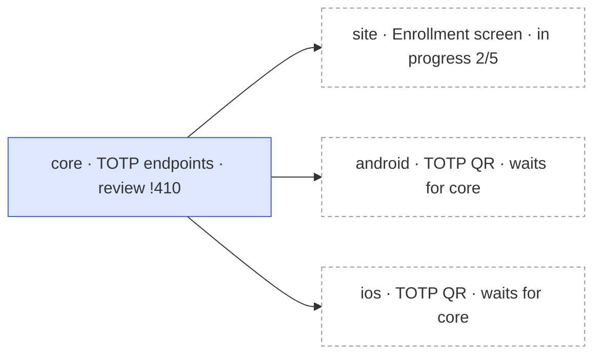

# 04 · UX: the metro roadmap, surfaces and main flows

The user's brief for the UI: convenient day to day, and at the same time **visual, like a road map
for each project**, so the process of an umbrella project such as Laconote, with its many
sub-projects, can be seen **from far away**; study Obsidian and similar tools; offer several ways to
solve it and say what Paseo's plugin UI can do.

Four concepts were put to the user on 2026-10-25 (release map, metro, atlas with a mission-control
board, timeline). **The user chose the metro.** People without Paseo get a generated `ROADMAP.md`
(Mermaid and tables) and Obsidian Bases views in the plan repo.

Contents: what Paseo can render · how other tools show roadmaps · the concepts · **the metro in
detail** · surfaces · flows · for people without Paseo · Obsidian · sources.

## What Paseo's plugin UI can render (0.13)

Checked against the 0.13.0 plugin reference and the app bundle on this machine.

| Capability | Status | Consequence for the roadmap |
| --- | --- | --- |
| React Native primitives: `View`, `Text`, `Pressable`, `ScrollView`, `FlatList`, `TextInput`, plus `Animated`, `PanResponder` and `AccessibilityInfo` from `react-native` | Available on desktop, web, iOS, Android | Boxes, bars, circles, straight orthogonal lines, two-axis scrolling (nested scroll views), pulsing marks, drag gestures |
| SVG, canvas, Skia, Reanimated, gesture-handler, WebView libraries | **Not available** to plugin client code: the host provides only `react`, `react-native`, `@tanstack/react-query`, `zod` and the SDK entries [1] | No curves or free drawing; no pinch-zoom library (`ScrollView` zoom is iOS-only [4]) |
| Pure-JS libraries bundled with the plugin | Allowed (esbuild bundles them) | Layout math is possible; rendering stays in views |
| Host `Markdown` component | Documented to render "code blocks, tables, diagrams" [1] | **Mermaid**: the desktop bundle maps ` ```mermaid ` blocks to a Mermaid renderer and ships Mermaid (gantt, flowchart, timeline, kanban, …). Read-only, no callbacks into plugin code. Each diagram shows its Mermaid source until its first render is done (Paseo 0.13.2 desktop: `packages/app/src/components/markdown/fence/mermaid/host.web.tsx`), so every newly drawn diagram flashes its text once; a plugin cannot turn that off. Native iOS/Android rendering is documented but not verified here |
| `Icon` with `{ svg }` | One static SVG up to 64 KiB, no scripts or styles [1] | Icons, not diagrams |
| `DocumentFrame` (0.13) | Shows a local file URL, HTML fully sandboxed without scripts [1] | Static files in file panels only; not used |
| Screens with params, sidebar items (several rows, trailing badges, popovers), workspace and agent panels, header buttons, composer pills, Command Center, slash commands, timeline cards, `Modal` (bottom sheet on phones), toasts, settings components | Available [1] | All surfaces listed below |
| Server → client push for plugin data | **None** | Screens poll the plugin's RPCs and refresh on Paseo's own agent events |
| `layout.compact` | `true` on phones and narrow windows | Every view needs a defined compact layout |

Two consequences shape the design:

1. **Zoom is semantic, not optical.** "Far away" and "close up" are levels you move between
   (space → line or feature → task), each laid out for its level, rather than one canvas you scale.
   This works the same with a mouse, a finger and a screen reader.
2. **Read-only pictures can be Mermaid text.** The same text renders in Paseo's `Markdown`, on
   GitHub [28], on GitLab [30] and in Obsidian [26], which is how people without Paseo see the roadmap.

## How other tools show roadmaps

Twelve patterns, from the UI research of 2026-10-25. Levels: P portfolio, Pr project, F feature,
T task.

| # | Pattern | Examples | Level | Encodes | Phone | Drawing |
| --- | --- | --- | --- | --- | --- | --- |
| 1 | Kanban + swimlanes | GitHub Projects board [44], Jira swimlanes [47], Vibe Kanban, Obsidian Bases kanban (1.14) [13] | F/T | status columns; lanes by feature or repo | one column at a time | none |
| 2 | Timeline / Gantt | Linear timeline with milestones and dependencies [32], GitHub roadmap layout [38], Jira [46], Notion [48], Plane critical path [53] | P/Pr/F | time, dates, dependencies | poor | bars from views; dependency lines need SVG |
| 3 | Now / Next / Later | ProdPad's roadmap [56] | P/Pr | horizons instead of dates | good | none |
| 4 | Tree with roll-up progress | Linear initiatives [30a], GitHub sub-issues and progress fields [39][40], Notion rollups [50], Plane modules [52], Logseq [62], Workflowy [63] | all | hierarchy, progress | excellent | none |
| 5 | Update feed with health | Linear project updates (on track / at risk / off track, staleness) [31], Shortcut [54] | Pr/P | health and why | excellent | none |
| 6 | Progress graphs | Linear project graph [34], Plane burn-down [51] | Pr/F | scope vs. done over time | sparkline only | lines need SVG |
| 7 | Feature × repo matrix | Patton's story map [57], adapted: one row per feature, one column per repo | Pr/F (P folded) | one branch → N repos → N MRs | glyph strip per feature | none |
| 8 | Metro map | "Automatic Layout of Project Plans Using a Metro Map Metaphor" [58], Miro metro roadmap [59] | P | lines, stations, interchanges, order | one line as a vertical route | orthogonal grid from views; curves need SVG |
| 9 | Canvas | Obsidian Canvas / JSON Canvas [9][10], Heptabase [60], tldraw [61], AFFiNE [65] | free | whatever people lay out | view only | pan, zoom, lines |
| 10 | Link graph | Obsidian graph view [8], Anytype [64] | exploration | links | poor | force layout |
| 11 | Triage inbox | Linear Triage: accept, decline, duplicate, snooze [35] | T/F input | provenance, suggestions | excellent | none |
| 12 | Mission control / attention queue | Linear agent sessions and `elicitation` [37], GitHub mission control [45], Warp notifications [70], AgentsRoom "waiting for input" [71], Cursor 2.0 agents sidebar [68], Conductor [67] | T/agent | who waits for a person, oldest first | excellent | none |

What the research settled:

- Agent tools converge on three things: a list of sessions with the ones waiting for a person on top,
  a separate review queue, and notifications. The dashboard's live strip and needs-you queue follow
  that in every concept.
- Calendar bars say little about agent work that takes hours; dates matter for releases, not for
  individual tasks. The metro uses releases as columns, not a calendar axis.
- Tools disappear: Height shut down in 2025 [55], Vibe Kanban's company in 2026, Obsidian's Projects
  plugin is archived [19] and its Kanban plugin moved to a community archive [15]. Plain files and core
  formats outlive them.

## The four concepts that were offered

Glyphs used in all of them: `✓` done, `◇` review, `►` agent working here, `!` needs you, `✕` failed,
`◐` in progress but not on this Mac (running on another machine, or a tracked trunk checkout whose agent ended: no failure, though Needs you lists it as `checkout` since only a person moves it on); an agent of this Mac that waits for a person or is gone shows `!`, as Needs you lists it,
`○` todo, `⊘` blocked by a dependency, `·` repo not involved.

| Concept | Idea | Strength | Weakness | Outcome |
| --- | --- | --- | --- | --- |
| **A · Release map** | Rows: features grouped by release; columns: repos; cells: task glyph | Mirrors "one branch → N repos → N MRs"; lowest risk; good on phones | Less of a picture | Not chosen as the main view; its per-feature glyph strip is the metro's compact form |
| **B · Metro** | Lines: repos; stations: tasks; interchanges: features; columns: releases | The most "roadmap" view from far away; order and spread visible at once | Harder to build; dense with many features; the full map does not fit a phone | **Chosen** |
| **C · Atlas + mission control** | Finder-like columns with roll-up bars; a board with a swimlane per feature | Most practical day to day | Least like a road map | Its board is reused as the Live tab |
| **D · Timeline** | Releases and features on a calendar (Mermaid gantt) | Cheapest picture | Fake precision for agent work | Kept as a Mermaid diagram in `ROADMAP.md` when releases have dates |

A fifth idea, a **canvas shared with Obsidian** (`.canvas` file laid out by people, live status on
top), was kept for later: hand layouts go stale with hundreds of tasks and need pan and zoom that
Paseo's plugin UI does not have.

## The metro in detail

### The map (desktop, wide layout)

```text
┌ Laconote ▾      ! 1 needs you   ► 3 working   ◇ 2 review   Inbox 4          [Labels ◉] [Done ▸] ┐
│                                                                                                  │
│            Release 2.3 · Nov 30 · 12 days        ┆ Release 2.4 · Dec 21   ┆ Later                 │
│            ███████░░░░ 7/18  ! 1  ⊘ 3            ┆ ░░░░░░░░ 0/6           ┆                       │
│            TOTP 2FA    Promo codes  Share notes  ┆ Billing v2             ┆ Offline sync          │
│ core       ━━━◇━━━━━━━━━━━✓━━━━━━━━━━━!━━━━━━━━━━┿━━━━━━○━━━━━━━━━━━━━━━━┿━━━━━━○━━━━━━━━━      │
│               ┃           ┃                      ┆      ┃                 ┆      ┃                │
│ site       ━━━►━━━━━━━━━━━✓━━━━━━━━━━━○━━━━━━━━━━┿━━━━━━○━━━━━━━━━━━━━━━━┿━━━━━━⊘━━━━━━━━━      │
│               ┃           ┃                      ┆                        ┆      ┃                │
│ android    ━━━⊘━━━━━━━━━━━✓━━━━━━━━━━━━━━━━━━━━━━┿━━━━━━━━━━━━━━━━━━━━━━━┿━━━━━━⊘━━━━━━━━━      │
│               ┃           ┃                      ┆                        ┆      ┃                │
│ ios        ━━━⊘━━━━━━━━━━━✓━━━━━━━━━━━━━━━━━━━━━━┿━━━━━━━━━━━━━━━━━━━━━━━┿━━━━━━⊘━━━━━━━━━      │
│               ┃                                  ┆                        ┆                       │
│ backoffice ━━━◐━━━━━━━━━━━━━━━━━━━━━━━━━━━━━━━━━━┿━━━━━━○━━━━━━━━━━━━━━━━┿━━━━━━━━━━━━━━━━      │
│ desktop · chrome · mcp · docker: faint empty lines (or one muted row with "Empty lines" off)     │
├──────────────────────────────────────────────────────────────────────────────────────────────────┤
│ DEPOT · Inbox 4   [Android: TOTP QR]  [Backoffice: force 2FA]  [Recovery-code count]  [+1]      │
└──────────────────────────────────────────────────────────────────────────────────────────────────┘
  tap a station → task · tap ┃ or a feature title → feature · tap a line name → line · tap a chip → triage
```

- **Lines** are the space's projects in `space.yaml` order, core first. A line runs left to right
  through the releases. Lines with no station in the visible columns fold into one row.
- **Columns** are releases ordered by due date, then `order`, then **Later** (features without a
  release). Finished releases fold into one narrow **Done** column, opened with "Done ▸". An open
  task of a finished or canceled release shows in Later, so open work never hides in Done.
- **Interchanges** are features: a vertical bar in the release column that crosses the lines of the
  projects the feature has tasks in. The title sits above; the branch shows on press. A task's
  release is its own milestone, else its feature's, so a feature whose tasks are in several releases
  has an interchange in each of them.
- **Stations** are tasks, on the interchange at their project's line. A task without a feature is a
  station on its line in its release's column. Two tasks of one feature in one repo show as one
  station with a count; pressing it lists them.
- **Station marks** use the glyphs above, each also with a color from the theme (`statusSuccess` for
  done, `accent` for review and working, `statusDanger` for needs-you and failed,
  `foregroundMuted` for the rest), never color alone. A working station pulses (`Animated`), unless
  the system asks for reduced motion.
- **Release headers** show the title, due date, days left or overdue, a progress bar, and the counts
  of needs-you and blocked tasks.
- **The live strip** (top of every dashboard screen): needs you, working, review and inbox counts;
  each opens the Live tab filtered to it, needs-you first and oldest first.
- **The depot** holds inbox drafts as chips; tapping one opens triage, where choosing the project,
  feature and release places it on the map.
- **Labels on / off**: with labels, task titles appear next to stations (the near view); without,
  columns shrink to glyphs (the far view).
- Dependencies between features are not drawn on the map; a blocked station shows `⊘` and the feature
  view shows the order.

**The look after the first hand check (2026-10-26).** The first build stacked four rows of identical
pills above the map and drew every line grey. Now:

- One header row: the space's name, the live counts as status badges (a zero is muted, needs-you
  turns red), and "+ Task", "+ Feature", "+ Release". Below it underlined tabs. Map options are
  check toggles ("Titles", "Empty lines", "Finished releases") and, when projects have groups, group
  chips that narrow the map to one umbrella.
- Each line has its project's color (`space.yaml` `color`, else the next palette color no project
  names); the line name is a badge in that color, and a group's name sits above its first line.
  Lines without a group come after the groups, under "No group".
- Every project of the space is a line, also before it has a task: such a line is drawn faint
  ("Empty lines" off folds them into one muted row, as the first build always did). A project added
  on the Projects tab therefore shows on the map at once.
- Releases are filled panels with a progress bar on a visible track and "3/7 done · 43%"; Later and
  Done are dashed outlines without a bar ("not scheduled", "finished releases").
- Columns stretch to the screen's width (up to 2.2×) instead of hugging the left edge.
- A station is a ring in the line's color with the status mark inside; needs-you and failed add a
  red halo, working an accent halo. A cluster has a count badge and the title "first task +N"; its
  status counts the tasks by mark, most urgent first ("13 tasks · 4 review · 1 in progress · 8 done"),
  since the ring shows only the most urgent one. The title sits above the line and the status below
  it, so the line runs on unbroken.
- An interchange is an outlined capsule around its stations, under a "TOTP 2FA 0/3" tag.
- A one-row legend of the marks sits under the map.
- The Roadmap tab shows `ROADMAP.md` with its diagram colors swapped for dark ones on a dark theme
  (the file keeps GitHub's light colors), and the releases' time axis only once there are two dated
  releases.

### The feature view (an interchange)

```text
┌ ‹ Laconote · TOTP 2FA                            Release 2.3 · feat/totp-2fa · 3/8 ┐
│ Phase 1                Phase 2 (after core)                                         │
│ ◇ core  TOTP endpoints ─┬─▶ ► site       Enrollment screen    2/5 · working        │
│   review · !410         ├─▶ ⊘ android    TOTP QR screen       waits for core       │
│   checks passing        ├─▶ ⊘ ios        TOTP QR screen       waits for core       │
│                         └─▶ ◐ backoffice Force 2FA            running on anna-mbp  │
│ [+ task for desktop] [+ task for chrome]          [Start ready tasks] [Open spec]   │
└─────────────────────────────────────────────────────────────────────────────────────┘
```

Phases are the dependency layers computed from `depends_on`. Arrows are orthogonal lines built from
views. "Start ready tasks" starts every `todo` task of the feature whose dependencies are done and whose
project is mapped here, after one confirmation that names them, each as a confirmed start does
(D24); one whose instructions the person has not seen as they are now is skipped until opened, and a
few start per press so the answer comes in time. The Tasks and Live tabs have "Start next": the first task ready to start from this Mac in list
order, through its ordinary start confirmation. The task screen and the line screen have the
autopilot switch, and Live lists what is on autopilot, what each waits for, and what it started.

### The board

Decided by the owner on 2026-11-03 (refines D7): the metro shows the structure, but moving tasks
day to day is quicker in columns, so on wide layouts the space screen opens on **Board**, and
**Map** is the next tab. On a phone the space still opens on Lines; Board is the tab after it.

- **Columns** are the sections every task list cuts tasks into (`taskSection`, server/api/view.ts),
  left to right: Drafts, Ready to start, Blocked, Running, Review, Done. A column holds what the
  Tasks tab heads with the same name, in the same order (`sortTasks`; with a search the Tasks tab
  puts title matches first, the board keeps each column's order); Running and Review hold what
  Live lists as Working and Review. Canceled work has no column. Done lists the 50 latest finished
  tasks and counts the rest; any other column lists up to 200 and counts the rest. The board has its
  own read, `ui.board`, since `tasks.list` answers at most 50 a page.
  Each column fills the height of the tab and scrolls its own cards under its heading, so a long
  column moves on its own.
- **Work merged outside the dashboard.** A todo or draft card of a task that never ran, whose branch
  or a PR/MR among its links was merged after the task was created (03-model.md, Work merged outside
  the dashboard), says "✓ Work already merged:" with the PR/MR linked and offers "Mark done…"; the
  task screen says the same above its actions. The status changes only when the person confirms (a
  draft is accepted on the way).
- **Moves.** A draft card is accepted (inbox → todo; one without a project opens the accept form to
  pick it), a ready or blocked card goes back to the drafts (todo → inbox), and the order inside
  Drafts, Ready and Blocked changes through `tasks.rank` (D21: among the tasks of one priority). On
  the web and desktop apps a card drags: onto another column for its status, onto a card of its own
  column to go before or after it (the half it lands on). Everywhere each card has the same as
  buttons: Accept or To drafts, and ▲ ▼ (shown only while no filter or search hides a neighbour).
  Running, review and done follow the task's run (03-model.md, the transition table; I4): the board
  does not drop anything there or take their cards anywhere; their cards open the task, whose own
  actions (continue, release, mark done, reopen) stay the way. Ready and blocked follow
  dependencies, so neither takes a card from the other. A draft keeps an issue the mirror made for
  it while it was accepted (09-forge-issues.md, F5): the issue stays open as it was until the task is
  accepted again, finished or canceled.
- **Search and filters.** A field that filters the board (the words `tasks.list` searches; the same
  query as Tasks and Inbox, kept in the space screen's `q`) and, behind "Filters", Mine, one label
  and, across spaces, the space.
- **Keys** (web and desktop apps, while the board is on view and nothing is being typed): **n** a new
  task, **f** shows or hides the filters; **/** focuses the top bar's search ([The top bar](#the-top-bar)).
- A card opens its task in the inspector, carrying its column as the list to step through.

### The line view (one repo) and the phone

On a phone the full two-dimensional map does not fit; the space screen opens on the **lines list**,
and each line opens as a vertical route:

```text
┌ Laconote ▾  ! 1  ► 3  ◇ 2 ┐   ┌ ‹ core ─────────────────────┐   ┌ ‹ TOTP 2FA · 3/8 ─────────┐
│ [Lines] Board Features Map│   │ ┃ Release 2.3 · 12 days      │   │ core  ◇ review !410       │
├───────────────────────────┤   │ ◇ TOTP endpoints   !410      │   │  ├─ site     ► 2/5        │
│ core       ◇ ✓ ! ┆ ○ ┆ ○   │   │ ┃  site► android⊘ ios⊘ …     │   │  ├─ android  ⊘ waits      │
│ site       ► ✓ ○ ┆ ○ ┆ ⊘   │   │ ✓ Promo codes               │   │  ├─ ios      ⊘ waits      │
│ android    ⊘ ✓   ┆   ┆ ⊘   │   │ ! Share notes  needs you    │   │  └─ back     ◐ anna-mbp   │
│ ios        ⊘ ✓   ┆   ┆ ⊘   │   │ ┆ Release 2.4               │   │ [Start ready] [Spec]      │
│ backoffice ◐     ┆ ○ ┆     │   │ ○ Billing v2                 │   ├───────────────────────────┤
├───────────────────────────┤   │ ┆ Later                     │   │ Map · Live · Inbox 4      │
│ Map · Live · Inbox 4      │   │ ○ Offline sync              │   └───────────────────────────┘
└───────────────────────────┘   └─────────────────────────────┘
```

- **Lines** (default on phones): one row per repo with its stations as glyphs, releases separated by
  `┆`. Tap → the line's vertical route: release sections, stations with title, status, PR/MR, and the
  feature's other repos as a small glyph strip ("transfers").
- **Features**: one card per feature with the repo glyph strip (the release-map form); tap → the
  feature view.
- **Map**: the full metro in glyph mode with two-axis scrolling, for orientation.

### Rendering and scale

- The layout is a pure function from the plan to positions (columns, rows, interchange spans), unit
  tested; drawing is absolutely positioned `View`s inside a content view of computed size, scrolled by
  a horizontal `ScrollView` inside a vertical one, with the line names in a fixed column outside the
  horizontal scroller.
- Line segments are 2–3 px views; interchanges are 4–6 px rounded bars; stations are bordered circles
  with the glyph as text; arrows in the feature view are orthogonal elbows. No SVG, no diagonals.
- Each station is a `Pressable` with an accessibility label such as "core, TOTP endpoints, in review,
  merge request 410".
- The element count grows with lines × columns, not with history: finished releases fold into one
  column. Phase 4's acceptance uses a fixture of 500 tasks in 6 projects
  ([07-plan.md](07-plan.md#phase-4--ui)).
- If phase 4 shows the map unreadable for a real plan, the fallback is the release map (concept A),
  which uses the same layout data without lines; the phone already uses it for the Features list.

## Surfaces

### The top bar

Decided 2026-11-03. Paseo owns a plugin
screen's header, so the space, line, feature and task screens start with their own row: "‹ Back"
where there is a way back, the search, and, off the space screen (whose live strip says it), the
needs-you count, which opens Live.

- **The search** is the plan's one search (`tasks.list`, server/search/core.ts): ids in any form,
  titles, labels, projects, features, releases, people and the text of tasks, in every state. Under
  the field, while something is typed: up to eight tasks with their mark, id, section, project and
  where they matched, the words in bold; then the features, releases and projects whose names match.
  A task opens in the inspector on the space screen, else as its screen; a feature and a project
  (its line) likewise; a release opens the Tasks tab with its title, which finds its tasks. "Show
  all N tasks" opens the Tasks tab with the words. With nothing found it says what was searched and
  offers every space; when the other keyboard layout or only some of the words found something, it
  says so.
- **Scope**: the space of the screen, with a chip "in LAC ×" that widens to every space; the
  all-spaces view and the sidebar search every space.
- **Empty field**: the places opened last (tasks, features, lines; ten, newest first), kept per Mac
  in `ui.json` (`ui.recent`).
- **Keys** (web and desktop apps): **/** focuses the search while its bar is on view (on a task,
  feature or line page scrolled past it, scroll back first); ↑ ↓ choose; Enter opens the chosen
  result, the first by default, of the words in the field (waiting for their search if it has not
  answered), so an id and Enter opens its task; Esc clears, then leaves the field.
- **The results** show while the field has the focus, at most a bounded, scrolling card; a press on
  one keeps them until it is done. On the space screen the bar has no "‹ Back": it is the home.
- **Elsewhere in Paseo**: a search icon on the sidebar row opens the same search in a popover (a
  bottom sheet on phones); Command Center's "Search Paseo Dash" opens the space screen with the
  search focused (one-shot `search`).
- The board's, Tasks' and Inbox's own fields filter their view; the three share one query, kept in
  the space screen's location (`q`), so a tab switch and "‹ Back" keep it.

### Registrations

| Surface | Registration | What it shows or does |
| --- | --- | --- |
| Sidebar group "Dashboard" | `addSidebarHeaderItem`, `SidebarRow`s with a trailing badge | While it is mounted, each new task event (a task's agent finished, failed or needs you; [05-architecture.md](05-architecture.md#task-events)) is a toast, the ones missed while the client was offline once it is back, never the old ones when the app opens. A search icon beside the count opens PD's search in a popover ([The top bar](#the-top-bar)). One space: its row with its needs-you count, opening its map. Two or more (D20): one "Dashboard" row with the total needs-you count, opening the all-spaces view; a row per space besides it only when Settings → Dashboard → Sidebar turns them on (off by default; this machine's `ui.json`) |
| Screen `space` | `addScreen` (params: space, tab, add, q: the words Board, Tasks and Inbox filter by, search: focus the search once) | Without `space` and with two or more spaces: the all-spaces view ([All spaces](#all-spaces)). Tabs: **Board** (the default on wide layouts: columns by task state, [The board](#the-board)) · **Map** (the metro) · **Live** (the control room, top to bottom: **Needs you** first, each row with how long it waits, "Open chat", and for an agent that finished its turn while its task is in progress "Reply", which sends the answer as written; **Working**, an agent that waits or failed first, then the longest running, an agent gone last (Needs you lists it); **Review**, the longest in review first; each with up to 200 rows rather than God Mode's ten, and how many more are not shown; then **Events**, the unread ones unless "Earlier" asks for the latest twenty, "Mark read"; **Recap**: what happened in the plan over the last 24 h, 3, 7 or 30 days, from the plan's commits, the same answer as God Mode's `recap`: counts by kind, then each change newest first with who, when, the change and "by hand" for a person's edit outside the dashboard, the first ten and "Show all"; a board with a swimlane per feature. The sidebar row opens Live while something waits for the person) · **Tasks** (filterable list; "Mine" and one label narrow it) · **Inbox** (the same two filters) · **Roadmap** (the space's `ROADMAP.md` in the host `Markdown`) · **Projects** (the lines: add from Paseo or by URL, order, color, group, map by hand, clone, remove; D18) · **People & labels** (the label palette and the people of `space.yaml`, 03-model.md; "Share this space": who has access to the plan repository, invite and remove, each after a confirmation, 09-forge-issues.md F4). Task cards, the line list and the task screen show label chips; a station shows its tasks' labels as dots in the near view; a label the palette does not define is drawn neutral and dashed. With no space yet it offers to create the plan repository on GitHub or connect one |
| Screen `line` | `addScreen` (params: space, project) | One repo's route |
| Screen `feature` | `addScreen` (params: space, feature) | The interchange view |
| Screen `task` | `addScreen` (params: space, task) | Brief (host `Markdown`), acceptance with ticks, activity, latest agent message, PR/MR, handoff, **Earlier runs** (every run of the plan's history but the live one, newest first: who, host, branch, start and end, result, PR/MR, progress note, its handoff; a run this machine started has "Open chat" and "Open workspace" and its agent's latest reply, another machine's run says on which machine its agent ran), actions |
| Settings screen | `addSettingsScreen` | Spaces (add by remote URL; disconnect from this machine after a confirmation that the plan repository and its remote stay untouched, refused with the reason while anything of the space is not pushed or a run of this machine holds it: [05-architecture.md](05-architecture.md#disconnecting-a-space); "Plan repositories you can join": the ones with the plan topic this machine's `gh` and `glab` logins read and that are not connected, each with Connect), per space: the setup check (a GitLab default branch Developers cannot push), the "Mirror issues" switch (off by default; turning it on asks first, says that briefs become issue text and that only one machine should mirror a space, and names the repositories the forge says are public; once on, the counts of mirrored and waiting issues, a host that asked to slow down, and each issue not written yet with the forge's words: [05-architecture.md](05-architecture.md#issue-mirror)), project mapping and the space's default agent profile (written to `space.yaml`); with two or more spaces, whether the sidebar shows a row per space; this machine's fallback agent profile, sync interval, Laconote URL and key; "Autopilot": this machine's limit of runs at work (1 to 20, default 3; a change counts at once, stops no run and changes no flag) with the slots in use as "X of Y" and each live run with whether it holds a slot and why (JOBBY-CB2NF); "Start new ready tasks" (on by default) and this Mac's default mode and effort of every start (Auto, High; JOBBY-H3ZEX, [06-god-mode.md](06-god-mode.md#starting-new-tasks)); "Starts asked through ChatGPT (God Mode) → Start tasks without asking" (off by default; this machine's `godmode.json`: [06-god-mode.md](06-god-mode.md#starting-without-asking)). The top bar's Settings button opens these two sections in a dialog, with a way to this screen |
| Workspace panel "Task" | `addWorkspacePanel` | The task this workspace runs, when it was started from the dashboard |
| Header button "Task" | `addHeaderButton` per task workspace | Opens the panel; label shows progress (`3/5`) |
| Composer pill | `addComposerPill` per task agent | `LAC-7K3QX · 3/5`; opens the task |
| Command Center | `addCommandCenterItem` | Global: "Search Paseo Dash" (the space screen with the top bar's search focused), "New task", "Open dashboard", "Import from Laconote"; workspace/agent context: "Open this task", "Mark task done" (a release while the run is live, so it opens the confirmation), "Move this task" (opens "Move…"), "Add this project to the dashboard" (opens the Projects tab with the workspace's project first) |
| Slash command `/task` | `addSlashCommand` (agent context) | `/task` opens the task; `/task done` opens the same confirmation as "Mark task done" |
| Timeline cards | `addTimelineRenderer` + `timeline.append` from the server | "Started from Dashboard: LAC-7K3QX · TOTP endpoints in core", "Moved to review: !412" |

Live data comes from the plugin's RPCs (polled while a screen is visible) and refreshes on Paseo's
agent events; needs-you items are always first. "Needs you" is one queue of everything the dashboard
cannot move on without the user, one row per task with what it asks for: a permission request, an
agent that finished its turn and waits (its last message, often a question), a failed agent, an
agent gone while its task is in progress (or a run this Mac holds with no record of its agent), a
tracked checkout on the trunk with no agent at work (whether its work landed on `origin/<trunk>`;
"mark done once landed", drawn `◐`, since its end is no failure), a PR/MR closed without a merge or
merged without the task done, a task in review with no PR/MR (accept or send back), and a space's plan changes that cannot
be pushed (no task to open: Settings → Dashboard shows it). A task whose PR/MR is open waits for the
forge and stays under Review; conflicts stay a count in Settings, since nothing clears them yet. The
header badge, the sidebar (per space too) and God Mode's `overview` count the same queue; the map's
"! n" over a release still counts permission requests only.

**In Paseo, not on the plan.** People also work in Paseo without a dashboard task. The dashboard
reads Paseo's open workspaces and archived agents (at most every 10 seconds, kept between reads) and
shows, for each line, the workspaces of its Paseo project that no dashboard task runs in: a count
under the line badge ("2 · 9 in Paseo": busy, meaning an agent works or waits, and open), a sheet with
the open ones (waiting or failed first, then working, then idle; each opens in Paseo) and "Earlier"
with the archived ones; the same lists on the line screen and, for open ones, on the Live tab.
Nothing is added to the plan by itself. "Track as task" on an open one takes it into the plan: a
confirmation with the title (the workspace's by default), what will be followed (its PR/MR, or, for a
checkout on the trunk, whether its commits landed on `origin/<trunk>`), and that its agent has no
dashboard tools, so progress comes from the agent's state and the PR/MR. It then opens the new task;
a workspace already tracked opens its task instead while that task's run lasts (once it ended, the workspace can be tracked again as new work) ([05-architecture.md](05-architecture.md#tracking-a-paseo-workspace-as-a-task)).

Every task list (the Tasks tab, a station's tasks, a feature phase, the inbox) follows one order
(06-god-mode.md, `tasks`; D21): running, review, ready, blocked, drafts, then done and canceled,
the latest finished first. The Tasks tab heads each section, shows each row's priority and release,
and pages with "Show more" past 50. Ready, blocked and draft rows carry ▲ ▼ (not while searching), and
the task screen ▲ ▼ and "To top": a move inside the task's priority (D21; 06-god-mode.md,
`update_task`). Stations and phases keep their own grouping; the order applies
inside each.

A station with several tasks lists them in the inspector (below). It was a card under the map, out of
sight once the map grew, then a sheet over the map that every opened task closed, so the next task of
the same station took four steps.

### The inspector

Decided 2026-10-27. Opening one task after another meant leaving the map each time: every task,
feature and line was a screen of its own, and back opened the map anew, without the station's list
and at the top. Paseo 0.13 gives plugin screens no back, replace or close (the SDK of 0.14.0-beta.1
has none either), so the space screen keeps what is opened from it in a panel of its own
(client/peek.ts, client/inspector.tsx):

- **What opens there.** From the space screen's map, Lines, Features, Depot, Live (events, needs
  you, working, review), Tasks and Inbox: a task, a station's tasks (its line, release and feature
  above them), a feature (its phases one under another) or a line. What opens from inside the panel
  (a task a task waits for, a feature's task, "Track as task") opens there too.
- **Where.** Wide layouts: beside the tab, 460 points wide, the map or list still in place with its
  scroll and filters; in the Live, Tasks and Inbox lists and the depot the row on view is marked.
  Phones: over the whole screen.
- **Its own steps.** "‹" and "›" go back and forward through what the panel showed, and the label
  beside them names where back leads; opening something from a step back drops the steps ahead.
  A task opened from a list (a station, a feature's phases, a line, a tab's list) carries that list:
  "↑" and "↓" with "3/12" move to the previous and next task in place, so back still leads to the
  list. "⤢" opens the entry as its screen (a station as its line's); "✕" closes the panel.
- **Keys** (web and desktop apps): Escape closes, ↑/↓ or k/j move through the list, Alt+←/→ go back
  and forward. Only while the panel is what is on view at its centre (not under a screen pushed over
  the space screen, not under a dialog's backdrop) and not while typing in a field; while a task
  from a list is shown, ↑/↓ step the list instead of scrolling. On a phone the buttons are the way.
- **Links.** The entry on view, without its list, travels in the space screen's `peek` param: a
  screen opened from the panel leads back to the space with the panel open on it, and a link to the
  space with `peek` opens it.

The task, feature and line screens stay, for what opens from outside the dashboard (Command Center,
`/task`, a composer pill, a timeline card, the workspace panel) and for "⤢".

### All spaces

Decided 2026-10-27 (D20). A person keeps one plan repository per audience, since git grants access
per repository, and sees all their work in one view: a view across the spaces the plugin already
holds, with no change to storage or the model. Entity ids never collide (each space has its own key
prefix); derived keys do (project keys such as `core`, the `later` and `done` columns, station keys
such as `later:-:core`), so everything derived carries its space.

- **Opening it.** With two or more spaces, the sidebar's "Dashboard" row and Command Center's "Open
  dashboard" open the `space` screen without a space. Its header says "All spaces" and links each
  space; a space's own screen links back with "All". A project to add (Command Center's "Add this
  project") still picks one space first.
- **Map.** One band per space, one under another, each headed by the space's name (tapping it opens
  the space) and each the space's own map: its release columns (open milestones by due date, Done,
  Later), then its groups of lines, then its depot. Spaces have different releases, so columns are
  never merged across spaces. `map.get` without a space answers the bands (`bands`, in the order of
  the spaces list); station and interchange keys are prefixed with the space key (`TST/later:-:core`)
  and the client keys every element of a band by its space. The group filter offers every space's
  groups and narrows each band; a band with none of the group's lines is left out. The phone's Lines
  and Features tabs are banded the same way.
- **Lists.** Tasks, Inbox and Live are one list across the spaces, each row tagged with its space's
  key, with a filter for one space. Tasks keeps the start order of 06-god-mode.md (`tasks`), across
  spaces; Live keeps needs-you first by waiting time; drafts stay oldest first. "Mine" is resolved in
  each space against its own `people` (the person whose emails hold this machine's git email there);
  Tasks and Inbox offer it, as their RPCs do. Live has no "mine": its needs-you and working items are
  this machine's runs, which wait for this person by definition, and Paseo's workspaces carry no
  assignee. The label filter offers every space's labels once by name. "In Paseo, not on the plan"
  lists every space's lines (`activity.list` without a space); one Paseo project can be mapped from
  several spaces, so a workspace shows once, under the first space's line that has it, and "Track
  as task" there tracks it into that space. The map's "in Paseo" count under a line badge stays the
  line's own: two spaces' lines on one Paseo project both count its workspaces, so a line whose
  repository is a line in another connected space too says "shared" after the count, leaving the busy
  number to the dot ("10 in Paseo · shared"; "also in JOBBY" without a count). The Projects tab names those spaces on the line: the same repository with its own
  tasks in each plan, nothing synced between them.
- **Writes go to the task's own space.** A task created from a line or a feature lands in that line's
  or feature's space, as before. "+ Task" in the all-spaces view lists every space's projects: a key
  one space holds decides the space; a key several hold (`core`), or no project (a draft), asks
  which space before anything else of the space (feature, release, tasks to wait for) can be picked.
  "+ Feature", "+ Release" and the Laconote import ask for the space first. Accepting or merging a
  draft stays in the draft's space.
- **Roadmap.** Each repository has its own `ROADMAP.md`, so the all-spaces Roadmap tab lists the
  spaces, each opening its own. Projects and People & labels are per space and are not offered in
  the all-spaces view.

**Back.** Paseo 0.13 gives plugin screens no back navigation, so the line, feature and task screens
carry their own "‹ Back" row (client/history.ts). Inside the space screen the inspector has its own
steps instead (The inspector, above). "‹ Back" returns to the dashboard screen they were opened
from, with that screen's tab, map filters and inspector entry (kept in the space screen's params); one-shot params
(open a form, mark done, a notice) are not repeated. A screen reached from outside the dashboard
(sidebar, Command Center, a composer pill, a timeline card) starts afresh, and its "‹ Back" goes to
its parent: a task to its feature, else the space's map; a feature or a line to the map. Paseo's
own back (the header arrow on a phone, Close on desktop) pops its stack without telling the plugin,
so "‹ Back" skips entries that are the screen on view. Plugins cannot pop Paseo's stack, so "‹ Back"
opens the previous screen anew; Paseo's own back then walks through those copies too.

## Main flows

**Create.** ⌘K "New task", "+" on a line or an interchange (prefills space, project, feature and
release), or ChatGPT. A modal (a bottom sheet on phones) with title, project, feature, release,
priority, brief, acceptance lines and dependencies. Saving shows the station at once; a small sync
mark shows until the change is pushed.

**Triage the inbox.** The depot or the Inbox tab: one card per draft with its source (meeting title
and link) and suggested project. Actions: accept (set project, feature, release; becomes `todo` and
appears on the map), edit, merge into another task (cancels the draft and sets its `duplicate_of` to
that task, so the draft, its text and its meeting link show as a backlink of the task, in Obsidian
too), reject (`canceled`). "Import from Laconote" opens the meeting list, then a meeting's summary
with its action items as checkboxes, then "Add N drafts". "Import from GitHub/GitLab" asks for a
project and, optionally, a forge label or milestone, lists that repository's open issues as
checkboxes (one some task already carries shows "already imported as LAC-…" and cannot be ticked),
then "Import N drafts"; each draft carries the issue's link, title, labels and quoted text
(09-forge-issues.md, option a). A forge that cannot be reached shows its CLI's message and nothing is
imported.

**Link an issue.** The task form's "Issue it stands for" takes a GitHub or GitLab issue URL (empty
takes it off). The task screen's Issue block links it and shows its state as this machine last read
it, with what to do when it matters: closed on the forge while the task is open ("mark it done or
cancel it"; nothing changes by itself), or still open while the task is done ("the forge did not
close it"). An issue on a host that is not the web host of any of the space's projects is not read. A project whose remote host is not its web host (`gitlab-ssh.example.com` →
`gitlab.example.com`) gets its web host on the Projects tab.

**Start.** From a station, the task screen or the feature view: "Start". Disabled with the reason
when the task is not `todo`, already has a live run, or its project is not mapped on this machine.
For a blocked task it lists the blocking tasks, each a row with its status that opens that task's
screen (closing the confirmation) and, when that task can start now, offers Start for it right there;
"Start anyway" starts the blocked task itself. On the task screen the "Waits for" tasks are links too
(a Tasks tab row only names them: the row opens the blocked task). The confirmation shows the branch,
the base, the agent profile, the permission mode with the provider's other modes as chips to switch
to (a mode that stops for approval, such as "Always Ask" or "Plan Mode", is warned about in red: its
agent waits for a person), the effort with the model's other efforts as chips (the profile's, else
the model's default, until one is picked), a field for clarifications (kept on the task under
`## Clarifications` and followed by the agent where they disagree with the brief or acceptance, so
a person need not rewrite the brief to disagree with part of it), whether the instructions (brief, acceptance,
the space's template) changed since this user last saw them, with the diff when they did, and, for a
task with an issue, whether its merge will close the issue or why not (another forge, a base or trunk
that is not the repository's default branch). A task that never ran whose branch already exists
shows where it is and its PR/MR instead, and asks first ([03-model.md](03-model.md#branch-names)):
merged work offers "Mark done" or "Start on <branch>-2"; other work offers "Continue on <branch>"
(disabled with the reason while another worktree has it checked out) or "Start on <branch>-2"; the
facts then show the chosen branch, and "Choose again" goes back. Then the
station shows "launching" and "Open chat" appears (`navigation.openAgent`).

**Follow.** Needs-you items lead every list, the live strip and the sidebar badge. A task shows its
activity, the agent's latest message, the acceptance ticks the agent reported, and the PR/MR with its
checks. "Open chat" goes to the agent; answering a permission happens in Paseo's own chat.

**Review and close.** The PR/MR chip opens the forge page. Merging closes the task automatically
when its acceptance lines are all ticked; otherwise the task says how many are left and waits for
"Mark done".
On a task with a live run, "Mark done", "Back to todo" and "Cancel" are **releases**: a dialog names
who holds the task, on which machine and since when, says that their agent is stopped (D23: on this
Mac at once, on another once that machine syncs, except for done; its chat stays), and asks to confirm
([03-model.md](03-model.md#statuses)). On the run's own machine, "Continue work" moves a
task from review back to in progress. "Reopen" is offered for done and canceled tasks. A done or
canceled task whose run's workspace is on this Mac offers "Archive workspace", a separate step after
a confirmation (never for a tracked Paseo workspace, which is the person's own).

**Move.** "Move…" on the task screen and in the workspace panel, and "Move this task" in the
Command Center (D19): a dialog with the task's project, feature and release as chips, "None" for no
feature and "None" (or "The feature's") for no release of its own. The project is offered only while
the task was never started; a started task shows its project with the reason instead, and so does
the task form's Edit. Only what changed is sent, together with where the dialog showed the task: if
someone moved it meanwhile the move is refused and names what changed, and a move that reaches
origin after someone else's conflicts on the `set`'s `expect` like any other edit.

**Result.** The task screen's Result block is where a person decides on a run's work without leaving
Paseo. It shows the PR/MR as the forge has it when the screen opens or on "Refresh" (`ui.task-result`,
read with `gh pr view` / `glab mr view` in the project's checkout, never on a timer):
- its title, state (open, draft, merged, closed), branches, and why the tracker moved nothing (a
  draft, a merge with acceptance left);
- the changed files with their line counts (GitHub lists up to 20 and counts the rest; GitLab gives
  the count only);
- the checks summed up as passing, failing with the failed names, running, or none (GitLab: the head
  pipeline, linked, and "waits" for a manual job or a schedule);
- the review decision. On GitLab it comes from `detailed_merge_status` (`not_approved`,
  `requested_changes`); Community Edition has no required approvals, and whether it reports
  requested changes there is not verified, so on a self-hosted GitLab it may stay empty.

A task in review offers "Accept and mark done…" (the release to done, confirmed) and, on the run's
own machine, "Send back": the person's comment goes to the agent as its next message and the task
returns to in progress (`tasks.send-back`, refused while the agent is still working; on a task already
in progress the comment is only sent; on a tracked Paseo workspace the comment is only sent and the
task stays in review, since its agent cannot report the work done again). A task in review
without a PR/MR (an agent that reported the work done, such as a decision or research task) shows the
same two answers. Neither RPC is described to God Mode: ChatGPT reads `task` and talks to the agent
with God Mode's own `send_message`.

**Zoom.** Map → feature (interchange) or line → task, in the inspector beside the map, which stays
mounted with its scroll position. A task, feature or line opened as its own screen ("⤢", or from
outside the dashboard) leads back to the space screen opened anew, at the top.

## For people without Paseo

Agreed with the user: the plan repo carries two extras.

**`ROADMAP.md`, generated.** Rendered by the plugin from committed plan state only, with no
timestamps of its own, so every machine renders the same text (see
[05-architecture.md](05-architecture.md#derived-files)). It contains, per active release:

- a Markdown table "feature × project" with the same glyphs as the metro and a legend (readable on
  every renderer, including phones);
- a Mermaid `flowchart LR` per active feature: core first, then the clients, nodes styled by status
  with `classDef`;
- a Mermaid `gantt` of the releases with their due dates, when the releases have dates.

GitHub [28], GitLab [30] and Obsidian [26] render it without plugins. Titles are escaped before they
go into Mermaid labels and table cells, so quotes, brackets or pipes in a title cannot break the
file. Example of the per-feature diagram:



**Obsidian Bases views, written once.** `views/tasks.base` (open tasks as a table, and grouped by
status as a kanban, the layout Obsidian added to Bases in 1.14 [13]) and `views/roadmap.base`
(features grouped by release). They are written when a space is created and then belong to the
people who use them. The exact view type name for the kanban layout is checked against Obsidian's
documentation when the template is written in phase 4.

## Obsidian interoperability

- **The plan repo is a vault.** Markdown files with YAML properties [6], flat as Obsidian's
  properties editor expects (no nested objects), references as quoted wikilinks
  (`feature: "[[LAC-2HV9D-totp-2fa]]"`), so backlinks [7], the graph [8] and Bases grouping work;
  acceptance checklists are ordinary task list items.
- **Not used:** the Kanban community plugin (a whole board in one file is a conflict hotspot, and the
  plugin moved to a community archive [15]); Obsidian Projects (archived [19]); Obsidian Sync for the
  plan (git is the sync; Sync's shared vaults merge Markdown with diff-match-patch and resolve other
  files by last write [22][23]).
- **Git in Obsidian.** People who edit the plan in Obsidian use their own clone and the Obsidian Git
  plugin or the command line; on mobile Obsidian Git is described by its author as very unstable
  [21], so phones use Paseo or the forge's web view. The plan repo's `.gitignore` excludes
  `.obsidian/workspace*.json`, the per-device layout file that otherwise conflicts [24].
- **Deep links.** The task screen can offer "Open in Obsidian" with an `obsidian://open?vault=…&file=…`
  URL [27] when the user sets their vault name in settings.

## Sources

1. https://paseo.sh/docs/plugins/reference
4. https://reactnative.dev/docs/scrollview
6. https://obsidian.md/help/properties
7. https://obsidian.md/changelog/2023-08-31-desktop-v1.4.5/
8. https://obsidian.md/help/plugins/graph
9. https://obsidian.md/help/plugins/canvas
10. https://jsoncanvas.org/spec/1.0/
13. https://obsidian.md/changelog/2026-09-02-desktop-v1.14.0/ ("Bases: Added a new kanban layout")
15. https://github.com/community-archive/obsidian-kanban
19. https://github.com/marcusolsson/obsidian-projects
21. https://github.com/Vinzent03/obsidian-git
22. https://obsidian.md/help/sync/collaborate
23. https://obsidian.md/help/sync/troubleshoot
24. https://forum.obsidian.md/t/help-to-resolve-the-conflict-not-a-file-obsidian-workspace-json/76087
26. https://obsidian.md/help/advanced-syntax
27. https://obsidian.md/help/uri
28. https://docs.github.com/en/get-started/writing-on-github/working-with-advanced-formatting/creating-diagrams
30. https://docs.gitlab.com/user/markdown/ (Diagrams and flowcharts: Mermaid)
30a. https://linear.app/docs/initiatives
31. https://linear.app/docs/initiative-and-project-updates
32. https://linear.app/docs/timeline
34. https://linear.app/docs/project-graph
35. https://linear.app/docs/triage
37. https://linear.app/developers/agent-interaction
38. https://docs.github.com/en/issues/planning-and-tracking-with-projects/customizing-views-in-your-project/customizing-the-roadmap-layout
39. https://docs.github.com/en/issues/tracking-your-work-with-issues/using-issues/adding-sub-issues
40. https://docs.github.com/en/issues/planning-and-tracking-with-projects/understanding-fields/about-parent-issue-and-sub-issue-progress-fields
44. https://docs.github.com/en/issues/planning-and-tracking-with-projects/customizing-views-in-your-project/customizing-the-board-layout
45. https://github.blog/ai-and-ml/github-copilot/how-to-orchestrate-agents-using-mission-control/
46. https://support.atlassian.com/jira-software-cloud/docs/manage-epics-on-the-roadmap/
47. https://support.atlassian.com/jira-software-cloud/docs/configure-swimlanes/
48. https://www.notion.com/help/timelines
50. https://www.notion.com/help/relations-and-rollups
51. https://docs.plane.so/core-concepts/cycles
52. https://docs.plane.so/core-concepts/modules
53. https://docs.plane.so/core-concepts/issues/layouts
54. https://www.shortcut.com/help/views/roadmap-overview
55. https://alternativeto.net/news/2025/3/height-project-management-tool-to-shut-down-by-september-2025/
56. https://www.prodpad.com/blog/invented-now-next-later-roadmap/
57. https://www.jpattonassociates.com/the-new-backlog/
58. https://www.cs.kent.ac.uk/pubs/2005/2257/content.pdf
59. https://miro.com/templates/metro-roadmap-by-lisa/
60. https://wiki.heptabase.com/fundamental-elements
61. https://tldraw.dev/
62. https://github.com/logseq/docs/blob/master/pages/Tasks.md
63. https://workflowy.com/help/boards
64. https://doc.anytype.io/anytype/organize/views
65. https://github.com/toeverything/AFFiNE
67. https://www.conductor.build/docs/concepts/workspaces-and-branches
68. https://cursor.com/changelog/2-0
70. https://docs.warp.dev/agents/capabilities/agent-notifications.md
71. https://agentsroom.dev/docs/needs-input-inbox

Numbers follow the research notes; gaps are sources not used here.
