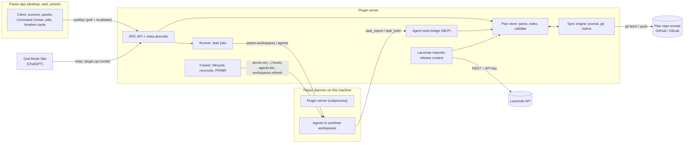
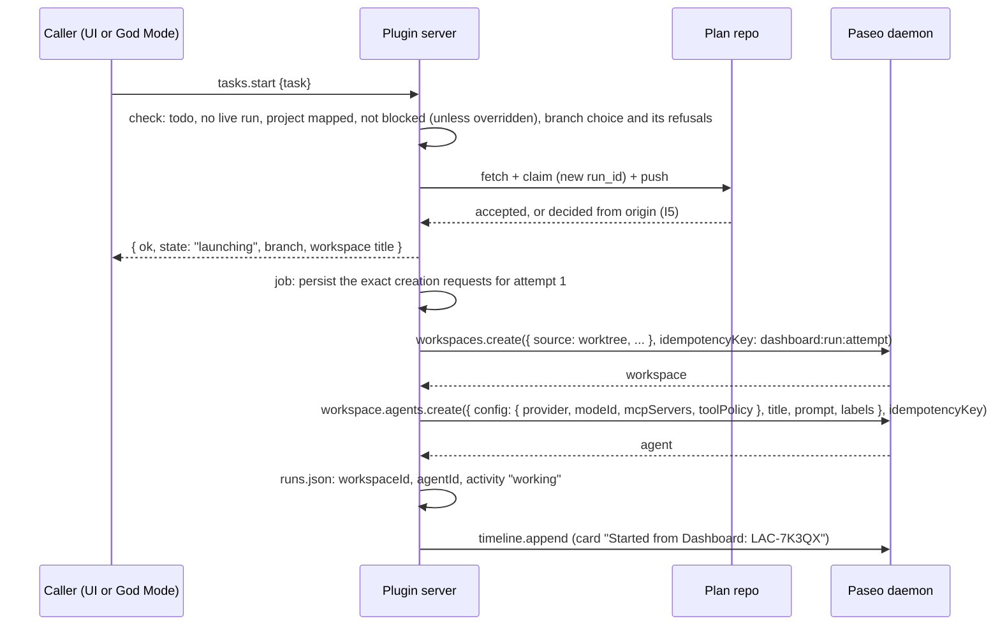

# 05 · Architecture

How the plugin is built on Paseo 0.13: its parts, where state lives, how several people's machines
stay consistent through the plan repo, how a task becomes a running agent, how progress comes back,
and what can fail. The data model is in [03-model.md](03-model.md); the ChatGPT surface is in
[06-god-mode.md](06-god-mode.md).

Platform facts this design relies on, with their sources, are collected at the end
([Platform facts](#platform-facts-relied-on)).

## Parts



| Part | Responsibility | Notes |
| --- | --- | --- |
| **Plan store** | Parse and write `space.yaml` and entity files, validate with the shared zod schemas, keep an in-memory index (by id, project, feature, milestone, status), compute derived flags, progress and the instructions facts | Every dashboard read is served from memory: no git, disk or network work. The one exception is the pre-start check (`tasks.start-check`, see [What a start sends](#what-a-start-sends)) |
| **Sync engine** | Own clone per space, operation journal, fetch, commit, push with replay, the start claim | One serial queue per space; see [Sync and concurrency](#sync-and-concurrency) |
| **Runner** | Turn "start task" into a claim, a worktree workspace and an agent; persist each step | Asynchronous job; the RPC returns after the claim |
| **Tracker** | Map Paseo lifecycle events to run activity, read the latest agent message, reconcile after restarts, read PR/MR state, apply the automatic transitions | Hooks are best effort and never replayed, so reconciliation is mandatory |
| **Agent tools bridge** | Give task agents two tools: `task_brief` and `task_report` | Injected by the runner at agent creation; preapproved so they never prompt |
| **Laconote importer** | List meetings, read a meeting's summary and action items, create inbox drafts with provenance | API key stays on the server |
| **Release context** | Push each mapped project's open milestones to Laconote, so its delivery meetings show the release, the due date and the days left | Same key; see [Release context](#release-context) |
| **RPC API** | Contracts in `shared/`, handlers in `server/`, `meta.describe` for God Mode | Same zod contracts render the God Mode description |
| **Client** | Screens, panels, Command Center items, composer pill, timeline renderer | React Native primitives and the host UI kit only; see [04-ux.md](04-ux.md) |

### Repository layout of the plugin

```text
paseo-plugin.json        id "dashboard", requirements.paseo ">=0.13.0"
OVERVIEW.md              listing page text
index.server.ts          contribute(server): handlers, hooks, timers; returns its cleanup function synchronously
index.client.tsx         contribute(client): screens, panels, items; returns cleanup
server/
  context.ts             lazy capture of `paseo`, data paths, the owner lock, logger
  store/                 schema use, parse/serialize, index, derived state
  sync/                  git runner, journal, replay, claim
  runner/                start jobs and prompt building
  tracker/               hooks, reconciliation, PR/MR
  agent-tools/           MCP bridge for task agents
  laconote/              REST client, importer and release context
  api/                   RPC handlers, capabilities (meta.describe)
shared/
  model.ts               zod schemas of entities and statuses, the transition table
  contracts/*.ts         defineRpc contracts
client/                  screens, panels, components
tests/                   node --test suites; temp PASEO_HOME and temp git remotes
```

## Lifecycle of the server part

- `contribute(server)` registers handlers, hooks and settings, starts nothing slow, and returns its
  cleanup function synchronously (Paseo refuses a contribution that returns a promise; the cleanup
  itself may be async).
- **One writer per daemon home.** At start the server takes `plugin-data/dashboard/owner.lock`: its
  PID, a random instance token, and a heartbeat it rewrites while it runs (the idea of
  paseo-session-guard's lock; that plugin reads boot identity from `/proc`, which macOS lacks). A lock
  is stale when its PID is not alive or its heartbeat is older than a few intervals, which also covers
  a PID reused by another process; a stale lock is taken over. A second installation of the same code on the
  same daemon (for example `dashboard-dev` next to `dashboard` during development) finds the lock, does
  not sync or write, and shows why in its UI. The server cannot tell its own runtime id (Paseo passes
  none), so the lock, not the path, keeps the two apart.
- `paseo` is not available inside `contribute`; it arrives with the first hook event or RPC. The
  server keeps it in `context.ts`. The client calls a cheap `dashboard.hello` RPC when its sidebar
  item mounts, so reconciliation starts as soon as any client connects, not at the first agent event.
- Timers (fetch loop, PR/MR polling), child processes (`git`, `gh`, `glab`) and the bridge's socket
  are owned by one lifetime object and stopped in cleanup. Paseo terminates a plugin process whose
  cleanup does not finish promptly (the 0.13.0 daemon sends SIGTERM, then SIGKILL), so anything left
  running loses its in-memory state abruptly. Child processes are spawned with the SDK's
  `spawnProcess`/`execCommand` and terminated in cleanup.
- Every background promise has a catch: an unhandled rejection in the worker can take the plugin
  down, and Paseo does not restart a crashed plugin.
- On start (and after `dashboard.hello`): take the lock, load runtime files, open each space's clone,
  run the journal through [the pending check](#invariants), then reconcile runs with Paseo
  ([Reconciliation](#reconciliation)).

## Sync and concurrency

Several people, each with their own Paseo and plugin, write to the same plan repo. Agents and
people may also edit files by hand in their own clones. The sync engine has one rule: **the plugin
never asks git to merge text it wrote; it re-applies its own operations on top of what the remote
has.**

### The plugin's own clone

The plugin keeps a clone per space under `plugin-data/dashboard/spaces/<key>/repo/` and is the only
writer there. People who want to edit files by hand, open the repo in Obsidian, or let an agent plan
in it use their own clone; their pushes reach the plugin through fetch like anyone else's. This keeps
the plugin's `reset` and replay away from anyone's uncommitted edits.

### Operations

Every write is recorded as an operation before it touches a file. Each operation has a unique
`op_id`; operations produced by or for a task run also carry that run's `run_id`.

| Operation | Fields | Applies when | Already applied when |
| --- | --- | --- | --- |
| `create` | the whole entity | the id is not taken | a task with an `issue`: some task (any status) already carries that issue (see I1) |
| `set` | entity, field, value, `expect` (the value the writer saw) | the field still equals `expect`; a task's `project` only while the task has no `run_id` (D19) | the field already equals `value` |
| `brief` | entity, new text, `expect` hash of the old text | the brief still hashes to `expect` | the brief already equals the new text |
| `check` | entity, acceptance line text, done, optional `run_id` | a line with that text exists (and, with a `run_id`, that run is the live run) | the line already has that state |
| `claim` | task, new `run_id`, `run_by`, `run_host`, `run_branch`, `run_started`; replaces every `run_*` field and moves the previous `run_pr` into `links` | status is `todo`, or `in_progress` with no live run (unheld, [03-model.md](03-model.md#statuses)), and the task has no live run | the task's `run_id` is this `run_id` |
| `claim` with `create` (adoption) | as `claim`, plus the new task's `create` (type `task`, status `todo`, no `run_*` or `progress_*` field) | the id is not taken; the task is then created as `todo` and claimed in the same apply, so both land in one commit or neither does | the task exists and its `run_id` is this `run_id` |
| `progress` | task, `run_id`, done, total, note, at | that run is the task's live run | the same values are already there |
| `clarify` | task, by, text, at | the task exists; adds an entry to `## Clarifications` ([03-model.md](03-model.md#task)) | the section's last entry is by the same person with the same text, at any time |
| `handoff` | task, `run_id`, text, at | that run is the task's live run; replaces `## Handoff` ([03-model.md](03-model.md#task)) | that run's handoff already has this text |
| `transition` | task, allowed `from` statuses, `to`, `run_id` (run-scoped transitions) | status is one of `from` and that run is the live run (the transition table in [03-model.md](03-model.md#statuses)); for `to: done`, every acceptance line is ticked | status is already `to` |
| `close` | task, the revision it was checked on, optional `run_id`, the closure (when, machine, PR/MRs, facts) | still that revision; the facts at most 15 minutes old; the plan's holds (labels, requirements, QA, dependencies, acceptance, claim) still stand off; for a run, that run is live; this machine's rule still says `close` | the task is `done` with the same closure |
| `release` | task, `run_id` of the run being released, to | that run is still the live run | that run already has `run_ended` |
| `archive` | task, archived (yes or no), at | archiving: the task is `done` or `canceled`; writes `archived: <at>` ([03-model.md](03-model.md#archive)). Putting back: always; removes the field | the field is already there (archive) or absent (put back) |
| `label` | task, one label, add or remove | the task exists (an added label must be a usable name or one the palette spells) | the label is already there (add) or absent (remove), in any case |
| `label_def` | label name, its color and description or null, `expect`, optional `if_absent` | `space.yaml`'s definition still equals `expect`; a removal also needs no task to carry the label | the definition already equals the new one; with `if_absent` (a label someone typed), any definition |
| `person` | person key, name, emails, GitHub login, GitLab logins per host, or null; `expect` | the entry still equals `expect`; a removal also needs no open task assigned to the person | the entry already equals the new one |

A task's `labels` change only through `label`, never a list-valued `set` (the field is protected):
two machines adding different labels to one task would otherwise conflict on the whole list. A label
typed in the UI or by God Mode that the palette lacks is defined by a `label_def` journaled just
before the write that uses it, so both land in one commit; two machines defining the same label keep
the first push's color.

A task created for a forge issue (an inbox import, God Mode's `add_to_inbox` or `create_task` with
`issue`) is already applied when a task carrying the same issue exists, compared by host, path
without case and number (09-forge-issues.md, option a). Two machines importing one issue create two
drafts with different random ids; the second push is rejected, its replay finds the first draft and
leaves the journal without a commit, and its own local draft goes with the reset, together with any
edit made to it before that push (those show as conflicts on a task that no longer exists). That is I2's rule
applied to provenance instead of id. The answer names the task that carries the issue ("already
imported as LAC-…"). A `claim` with `create` never takes this path: an adopted task is new work, so
its create is refused instead.

Feature completion (D15) is a **derived** `transition` on the feature, without a `run_id`. It is
computed whenever the feature's task set changes, from the state before and after the change: after
applying a local operation, after a replay, and after a fetch that brings task changes from anyone
(another plugin, a person in Obsidian, the hub agent). Its precondition is that after-state, with
the same rules as [03-model.md](03-model.md#milestone-and-feature): every non-canceled task done (at
least one) for `done`; for a `done` feature, any change of its task set (a status change, a task
added, removed or moved in) after which a non-canceled task is not done, for `active`. So two machines that each close one of the last two tasks still end with one
transition: the second push is rejected, its replay sees every task done and adds the feature's
`done`. A derived transition whose precondition no longer holds is dropped silently, never shown as a
conflict, and duplicates are harmless (I2). A person's manual `done` or `active` stands until the
next change of the task set.

A `claim` with `create` is how a person adopts work already running in Paseo
([Tracking a Paseo workspace as a task](#tracking-a-paseo-workspace-as-a-task)). It is one operation,
so it follows I5 exactly as a start's claim does: decided from origin within the same deadlines, never
pushed again once undecided, and, when it is lost, refused or not started, it leaves the journal with
its task, so no `todo` task without its run is left behind. The new id is random (I1), so "lost" here
can only mean an id collision. The `create` never writes `run_*` fields: the claim part does, as for
any start.

"The live run" means `run_id` equals the operation's and `run_ended` is empty. A run-scoped operation
whose run is no longer live (released, finished, or replaced by a new claim) is dropped silently and
logged, not reported as a conflict.

### Invariants

The sync engine keeps these, and its tests check each one ([07-plan.md](07-plan.md#phase-1--plan-store-and-sync)):

- **I1 · Operations are identified.** Every commit the plugin makes lists the `op_id` of each
  operation it applies in a `Dashboard-Op:` trailer. An operation is pending exactly when its `op_id`
  is not reachable from `origin/<branch>`. The plugin keeps the set of seen `op_id`s up to date by
  reading the trailers of newly fetched commits, so the check is incremental. A pending operation
  leaves the journal in exactly three ways: its `op_id` reaches origin; re-applying it finds its
  effect already present (I2), and it leaves without a commit; or re-applying it is refused, and the
  refusal is reported (for a run-scoped operation whose run is no longer live, only logged; for a
  derived feature transition whose precondition no longer holds, dropped silently; for a run's
  transition to `done` that lands on a task with acceptance lines not ticked, unless it carries
  `archived` (the run's workspace was archived), dropped silently, and the next PR/MR check decides
  again; for a line color
  pinned for a change of space.yaml's projects, dropped silently, as it is whenever the change it was
  pinned for does not apply in the same pass). Pending
  operations are always applied to a clone reset to `origin/<branch>`: a local commit that never
  reached origin (a crash between commit and push) is discarded first, since its operations are
  still in the journal.
- **I2 · Applying is idempotent.** An operation whose effect is already present succeeds without
  writing ("already applied when" above). A failed precondition therefore always means someone else
  changed the thing, never "I did it before". A lost push acknowledgement or a crash between push
  and journal update can no longer turn the user's own change into a conflict.
- **I3 · A run writes only to its own live run.** The plan file carries the task's `run_id` and
  `run_ended`. Everything a run produces (agent reports, acceptance ticks from the agent, progress,
  automatic review and done transitions, the PR/MR link) carries that `run_id` and applies only while
  that run is the task's live run; otherwise it is dropped silently and logged. A run's handoff is
  such an operation too: the handoff of a released or finished run never lands. Late operations from a
  released or abandoned run, for example on a machine that was offline, cannot touch the task or the
  next run.
- **I4 · One live run per task.** A run is live from its claim until `run_ended` is set. A claim
  succeeds only when the task is `todo` and has no live run. A live run ends only by its **own**
  merged PR/MR with its acceptance ticked or its workspace archived (→ `done`; "own" as defined in
  [03-model.md](03-model.md#statuses): seen open during the run, or merged after `run_started`) or by
  an explicit, confirmed release (Paseo dialog, or God Mode
  `release_task`, `disruptive`), or, back to `todo`, by its own start failing before Paseo was asked
  for its agent (nothing can run under it; Starting a task). Ordinary edits (`update_task`, the plain status menu) never change the status of a
  task with a live run. Ending a run keeps its fields as history; the next claim replaces them.
  A claim also fixes the task's project for good (D19): a `set` of `project` on a task with a
  `run_id` is refused, also when it is replayed after a claim from another machine landed first, and
  a start whose task moved to another project or feature since its check refuses on the claim's
  fetched state, since the branch and the repository were decided from them.
- **I5 · A claim's outcome is decided from origin, inside the RPC limit.** The fetch before the
  claim, the claim's push and one deciding fetch each have a deadline, and together they stay under
  Paseo's 30-second RPC limit (defaults: 6, 10 and 6 seconds, configurable; see
  [Time budget of a start from ChatGPT](#time-budget-of-a-start-from-chatgpt)). Killing a local
  `git push` does not undo a ref update the server has already received, so only an unambiguous push
  result counts:
  - the push was accepted, or origin shows this `run_id` as the task's live run → **won**; the job
    continues;
  - the push was rejected (origin moved): fetch, reset and replay the claim as in the write path,
    while the budget lasts. The replay decides: another live run → **lost** ("already started by …");
    the task is no longer `todo` (canceled, done, deleted) → **refused** with that reason; in both
    cases the claim leaves the journal. Still startable → push again;
  - the push failed before sending anything (no connection, authentication refused, remote not
    found, recognised from git's error) → **not started**; the claim leaves the journal and the caller
    gets "could not reach the plan repo; nothing was started";
  - anything else (the push was cut at its deadline, the connection dropped mid-transfer, the
    budget ran out during replays, or the deciding fetch failed) → **unknown**; the RPC throws (God Mode then says it is unknown whether it
    took effect). The claim stays in the journal marked undecided and is **never pushed again**; at
    every later fetch it is won if origin shows its `run_id` (the job continues), and leaves the
    journal once origin has been read without it after the push process is long gone.
  - A claim of this machine that appears on origin after it was reported as not started or as gone is
    not acted on: the task shows as orphaned with that explanation, for a person to release or start.
- **I6 · A Paseo creation request is replayed only byte for byte.** See
  [Idempotency of workspace and agent creation](#idempotency-of-workspace-and-agent-creation).

### Write path

1. Append the operation to `journal.json` (fsync) and apply it to the in-memory index, so the UI
   answers at once.
2. In the space queue, on the clone reset to `origin/<branch>` (I1): apply pending operations to the
   files, `git commit` with a
   subject such as `dashboard: LAC-7K3QX todo → in_progress (ergo@ergo-mbp)`, the local git identity
   as author, and one `Dashboard-Op:` trailer per operation.
3. `git push`. On success, the operations' ids are on origin and they leave the journal (I1).
4. On a non-fast-forward rejection: `git fetch`, `git reset --hard origin/<branch>` (the clone is
   plugin-owned), reload the index, drop operations whose ids are now on origin, re-apply the rest
   (I2), commit, push again. Attempts are bounded by a time budget, not a count; claims use the
   deadline of I5. When the budget runs out, the operations stay pending and the space shows "not
   synced: N changes pending".
5. An operation refused on re-apply (its precondition fails and it is not already applied) is
   removed from the journal. A derived operation (feature completion) or a pinned line color is
   dropped silently; any other
   is reported: in the UI as a conflict to resolve ("Anna set the priority
   to urgent while you set high: keep yours or theirs"), to a waiting caller as a refusal with the
   reason, and as a count in `overview.spaces[].conflicts` for ChatGPT. A refused claim is not a
   conflict: it is reported to its caller with its reason ("already started by …", or the task's new
   status) and is not counted in `conflicts`.

Field-level operations mean two people editing different fields of one task, or different tasks,
never conflict. Only the same field changed concurrently does, and then a person decides.

### The claim: no double start across machines

Starting a task is the one operation that must not race. The remote's ref update is atomic, so a
push is a compare-and-swap:

```mermaid
sequenceDiagram
    participant A as Plugin on Ergo's Mac
    participant R as Plan repo remote
    participant B as Plugin on Anna's Mac
    A->>R: fetch (task LAC-7K3QX is todo, no live run)
    B->>R: fetch (task LAC-7K3QX is todo, no live run)
    A->>A: claim run r-a1 (run_by ergo); commit with its op_id
    B->>B: claim run r-b7 (run_by anna); commit with its op_id
    A->>R: push (fast-forward)
    R-->>A: accepted
    B->>R: push
    R-->>B: rejected (non-fast-forward)
    B->>R: fetch, reset, replay claim
    B->>B: not applied (live run r-a1), not already applied (run is not r-b7)
    B-->>B: refuse: "already started by ergo on ergo-mbp at 21:14"
    A->>A: create workspace and agent for run r-a1
```

- A claim needs the remote. If origin cannot be reached, the start is refused with the reason (or,
  after an unclear push, left undecided as in I5); there is no offline start in v1.
- A start that wins the claim but fails before Paseo is asked for the agent (the workspace step, or
  the branch check below) releases the claim back to `todo` by itself (I4): nothing can run under that
  run, and a held task with no agent would only wait for someone to release it by hand. A workspace
  this attempt made is archived when the branch check fails; one whose creation stayed unclear and
  could not be found stays in Paseo, and the message says so. The branch stays. A start that fails
  at the agent step keeps the claim and shows the failed step, because an agent asked for may still
  appear; ending that claim is a release by a person.

### Fetching

- A fetch loop per space (default every 60 seconds, configurable), plus a fetch before every claim and
  when a dashboard screen gains focus.
- **Sync** fetches now, outside the loop (added 2026-11-24): a person who pushed a task into the plan
  should not wait up to a minute without knowing when it shows. The space screen's header (every tab,
  the board included) has a Sync button for the space on view (every space on the all-spaces view),
  Command Center has "Sync Paseo Dash" (it opens the space screen, which syncs), and Settings keeps
  "Sync now" per space. Each asks `spaces.sync`, which runs one pass of the space's own queue (fetch,
  reload, re-apply and push what is pending) and is never skipped the way an overlapping loop tick is.
  The answer names each space's last good fetch and its problem: a fetch that failed (the remote's
  last line of `git fetch`, or that it did not answer in time), a push that failed, or a pass that
  could not update the plan. The header says "Synced 14:03" (the oldest of the spaces on view), and
  the problem in red until a later sync clears it; a sync still going on after Paseo's answer time
  goes on in the background, and the next read shows its result.
- After a fetch with new commits: read their `Dashboard-Op:` trailers (I1), reload the changed files
  into the index, recompute the instructions facts ([Security](#security)); pending operations are
  re-applied as in step 4.
- A file that does not parse or validate is kept out of the index and listed in the space's
  problems with the reason and the commit that introduced it. It is never rewritten or deleted by the
  plugin.
- Two files with one id are both listed as a problem; the plugin refuses writes to that id until a
  person renames one (the UI offers a rename that rewrites the references in the same commit). With
  random ids this needs a collision between two machines between syncs.

### Commit volume

Claims, status changes, creations and edits are pushed at once. Writes that arrive while a push is
already queued share it: many agents reporting at once queue one fetch and push behind the work in
hand, not one each, so a start's claim does not wait behind a queue of them (`syncSoon`,
server/sync/space-sync.ts; 2026-10-28). Coalescing `progress` per task into one operation per
interval, as first planned, is not built: each report is still its own operation, pushed with the
others of its moment.

### Derived files

`ROADMAP.md` (Mermaid and tables for people without Paseo, see
[04-ux.md](04-ux.md#for-people-without-paseo)) is rendered **only from committed plan state**, never
from runtime state, and contains no timestamps of its own, so every machine renders the same text for
the same plan. The plugin re-renders it inside each of its own commits that change the plan and
includes it only when the text differs; on a replay it is simply rendered again from the new state,
so it never conflicts. Titles are escaped before they go into Mermaid labels and Markdown tables
(quotes, brackets, pipes, line breaks), so a title cannot break the diagram. Its first line says it
is generated and must not be edited by hand. `views/*.base` are written once when a space is created
and then belong to the people who use them.

### Run history

A task's earlier runs (03-model.md, Task) are read from the plugin's own clone only when the task
screen (`task.runs`) or God Mode's `task` read asks, never in `contribute()` or the fetch loop. Two
`git log` calls up to the clone's HEAD: the paths under `tasks/` whose diffs add or remove the task's
`id:` line (`-G`, without rename detection, so a hand rename shows as the old path removed and the new
one added), then those paths with a whole-file diff per commit (merges against their first parent),
which gives the file as of each commit. Only versions whose front matter `id` is the task's count.
The answer is cached per clone and task for the HEAD it was read at; any commit, the plugin's own or
a fetched one, makes the next read go to git again. The runs this machine started add what
`runs.json` holds (agent, workspace, latest reply); the plan is not changed and no transcript is copied.

### Recap

What happened over a period (God Mode's `recap`, the Live tab's Recap block) is read from the
plugin's own clone when asked, never in `contribute()` or the fetch loop, and nothing is stored for it.
One `git log` per space, up to the clone's HEAD, over `tasks/`: commits since the start of the period
(committer date, at most 31 days back) with a diff of each task file with 100 lines of context,
without rename detection and without merge diffs, so each change is counted once, by the commit that
made it. Only a file's first hunk is read, and only when it starts at line 1: it holds the front matter
before and after the commit (a long brief or handoff is not carried along), and a change further down
leaves the front matter as it was. The two front matters, matched by `id` (a hand rename
is the old path removed and the new one added), is compared field by field: a new file is `created`
or `draft`, a new `run_id` is `started`, a status change is `review`, `done`, `merged`, `released` or
`status`, a progress note that becomes `blocked: …` is `blocked`. A commit without a `Dashboard-Op`
trailer is a person's edit outside the dashboard and is flagged, but reads the same way. At most
1,000 commits are read per space; a busier period says how far back it got. The last read is kept per
clone for its HEAD and serves any later start of a period until the next commit. A space whose read
takes over 10 s is left out of that answer with the reason, and its read goes on to fill the cache.

### What the plan repo needs

- The plan repo's default branch is the data branch (D13) and must accept direct pushes from every
  collaborator who uses the plugin. The first plan repo is on GitHub (D16): collaborators are invited
  with write access, and no branch protection rule or ruleset on the default branch may block a plain
  fast-forward push by them: no required pull requests, no required status checks, no required
  signed commits unless every collaborator signs, no push restriction that leaves a collaborator out.
  Blocking force pushes and requiring linear history are fine (the plugin never force-pushes and
  only fast-forwards). Planning changes that should be reviewed (a big spec) can still go through a
  PR from a person's own clone.
- On GitLab the default branch is protected for Maintainers unless changed, so a plan repository
  there needs "Developers + Maintainers" allowed to push to it, or every collaborator as Maintainer.
  Settings runs this as the space's setup check (`spaces.check`) and says how to fix it.
- Connecting a repository without `space.yaml` (`spaces.add` with a key and a name) makes it a new
  space only when it is empty or holds nothing but regular files a forge creates with a new
  repository, at the root: `README*`, `LICENSE*`, `.gitignore`. The plugin writes `space.yaml` and
  `views/*.base` on top of the existing commit, appends its line to an existing `.gitignore`, and
  pushes one commit to the default branch it found (an empty repository gets `main`); the branch
  name passes `check-ref-format` and `SAFE_BRANCH`, and the key is checked against the connected
  spaces and those being disconnected, before anything is written. The commit stages only the
  plugin's own paths, forced, so the repository's `.gitignore` cannot keep `space.yaml` out of it.
  Any other content, including a directory, or a symlink or submodule under one of those names, is
  refused with the paths found.
- Plan repositories carry the topic `paseo-dashboard-plan` (a GitHub topic, a GitLab project topic).
  The onboarding sets it on the repository it creates; Settings lists the repositories with it that
  this machine's `gh` and `glab` logins can read and that are not connected yet (`plans.available`).
  A repository created another way needs the topic added by hand to be listed.
- Collaborators authenticate to the remote with their own git credentials (SSH key or credential
  helper). The plugin never stores git credentials.
- **Sharing.** The People & labels tab invites a person to the plan repository and takes access away
  (`sharing.read`, `sharing.invite`, `sharing.remove`) with the inviter's own `gh` or `glab` login;
  the dashboard stores no token. The calls are in 09-forge-issues.md (Inviting a person through the
  forges' APIs). Both ask first in the UI and refuse without that confirmation; an invited person is
  listed in `people` in the same flow (one `person` operation), and removing access leaves their
  entry. None of it is described to God Mode.

### Disconnecting a space

Settings → Dashboard disconnects a space from this machine (`spaces.disconnect`, not described to
God Mode). The plan repository and its remote are not touched; only this machine stops syncing it.
Every check is in the handler, since any paired client can call it, and only the lock owner may
disconnect, as only it may connect.

- **Refused, with the reason and what to do,** while the space has journal entries not on origin yet
  (pending operations, claims in flight or undecided; I1, I5), a live run of this machine (the plan's
  `run_host`, or a run record the plan holds as live; I3, I4), or a run record with an unfinished start
  attempt or an undecided claim, which the runner would drive again at the next start. Pending
  operations of a space whose remote cannot be reached are not discarded: the refusal names the error
  and what is pending. Abandoned claims do not refuse: they leave the journal only when they show up on
  origin, so most never do. One that lands after the disconnect shows on origin as a live run of this
  host, which any machine can release.
- **Order.** The space first leaves the list of spaces, so no new call resolves it. Then, in the
  space's queue, after every write queued before it, the checks run again; anything journaled in
  between puts the space back in its place and refuses. Once they pass, the space's sync is closed:
  writes are refused, a claim is "not started", and nothing queued runs, so the journal is never
  written again (writing it would create its directory anew). A write a pass already took off the
  journal keeps the outcome that pass recorded. A caller that resolved the space earlier and writes
  later, such as a start that waits for `git config user.name` before its claim, is refused.
- **Then** the space leaves `spaces.json`, its finished run records leave `runs.json`, and
  `spaces/<key>/` (clone and journal) is deleted. Connecting the repository again clones it afresh.
  Connecting a space while it is being disconnected is refused.
- A registry record that failed to open is not in the list of spaces and cannot be disconnected; it
  stays in `spaces.json` with its warning until the repository is connected again, which replaces it.

## Starting a task

`tasks.start` runs these steps as a persisted job. The RPC returns once the claim's outcome is known
(I5), so it fits Paseo's 30-second RPC limit and God Mode's 45-second tool budget even when worktree
setup is slow; the client and ChatGPT follow the job through `tasks.get`.



### Time budget of a start from ChatGPT

God Mode gives a tool call 45 seconds in all (`gpt-site/core/mcp.mjs`). The confirmed second call of
`start_task` is the longest: the relay connection (up to 8 seconds, per God Mode's docs), the plugin
descriptions (up to 4), the target read `start_check` (its deadline, default 5) and `tasks.start`
(the claim's three deadlines, defaults 6 + 10 + 6). The defaults add up to 39 seconds, under the
budget. If an installation raises them beyond it, a slow start ends in God Mode's "unknown whether it
took effect", which I5 already handles: the claim is decided by later fetches and the next `task`
read shows the result.

### Idempotency of workspace and agent creation

Paseo 0.13.0 records an idempotency key together with a fingerprint of the whole request (everything
but the request id, type, subscription and the key itself: config with MCP servers, prompt, title,
labels). The same key with a different request fails with `workspace_request_key_conflict` or
`agent_request_key_conflict`, and a record whose outcome is unknown is returned as it is, without a
new attempt. So (I6):

- The key is per attempt: `dashboard:<run_id>:<attempt>`.
- Before the first call of an attempt, the job stores the exact requests it will send (prompt text,
  title, labels, config including the bridge's run token, workspace source). Recovering an unclear
  attempt (after a timeout, a plugin reload or a daemon restart) resends the stored requests
  unchanged with the same key.
- Any changed request is a new attempt with a new key: the retry without the agent tools bridge, a
  changed branch, a retry after a clear failure.
- When Paseo reports `outcomeUnknown` (a failure after provisioning started), the job reconciles
  before any new attempt: `agents.list({ filter: { labels: { "dashboard.run": run_id } } })` and the
  workspaces on the run's branch. A found agent or workspace is adopted (it was created by this run);
  only if none exists does a new attempt start.

### What a start sends

- **Workspace.** A worktree from the mapped Paseo project: `source: { kind: "worktree", projectId,
  action: "branch-off", branchName, baseBranch }`, titled like the run's agent,
  `<task id> · <task title>`. Which branch, decided before the claim (the start check and `start_check` refuse the
  cases that cannot start, so no claim is taken for a start that would fail anyway):
  - an earlier attempt of the same run → that attempt's branch;
  - an earlier run of this task whose branch's latest PR/MR is **merged** (whether the run ended by
    the merge or the PR/MR was merged after a release) → a fresh branch from the base with a numeric
    suffix ([03-model.md](03-model.md#branch-names)), never the merged one;
  - an earlier **released** run whose PR/MR is open, was closed without a merge, or never existed →
    continue on its branch (an open MR stays the same; after a closed one the agent opens a new MR):
    - on the same machine, reuse that run's workspace if it still exists and its old agent is not
      running (a new agent in it, `workspaces.ref(id).agents.create`); if the old agent still works,
      refuse with "stop the previous run's agent first";
    - otherwise, if the branch exists locally or on origin, check it out (`action: "checkout"`,
      `refName`); if it exists nowhere (it was never pushed from another machine), branch off with
      the same name;
    - when the released run was on another machine, the start's confirmation says that its agent may
      still push to this branch until someone stops it;
  - a task that never ran, and a branch of the computed name exists (locally or on origin) → nothing
    starts until the person chooses in the confirmation ([03-model.md](03-model.md#branch-names)):
    when its latest PR/MR is merged or it was merged into `origin/<trunk>`, "Mark done" or a fresh
    branch with a numeric suffix; otherwise continuing on it (`action: "checkout"`, refused while
    another worktree has it checked out, or while the forge or git cannot tell) or the suffixed name.
    The check also reads the branch's latest PR/MR, `git worktree list`, and for each tip
    `git merge-base --is-ancestor` and `git rev-list --first-parent` against the checkout's
    `origin/<trunk>` (merged in: an ancestor, not on the first-parent line), within the same
    deadline; the suffixed name needs none of these, only the names taken;
    `ui.start-check` answers what it found (`existing`) and `ui.start` sends the choice (`branch`).
    God Mode has no such choice: `start_check` and `start_task` refuse and say what the branch holds;
  - an earlier run whose `run_branch` is the project's trunk (an adopted checkout on the trunk; the
    trunk is the task's `base`, else the project's `trunk` in `space.yaml`, else the checkout's
    `origin/HEAD`) → treated like a merged run: a fresh task branch from the base and a new worktree,
    never the trunk and never that run's workspace.

  A previous run's workspace is reused only when Paseo reports it as a `worktree`. A person's own
  checkout (`local_checkout`, `checkout` or `directory`, which an adopted run may have run in) is never
  handed to a new agent; the start makes a new worktree instead. While that checkout still has the
  branch checked out, git refuses a second worktree on it, so the start fails at the workspace step
  (the branch check below): the person switches the checkout off the branch, or overrides the task's
  branch.

  Deciding this is the one place a check leaves the in-memory index: the pre-start check
  (`tasks.start-check`, also God Mode's `start_check`) looks the branch up locally and on origin
  (`git ls-remote`) and asks for the latest PR/MR of an earlier run's branch (Paseo's descriptor when
  the workspace exists, else the forge CLI), all within one deadline (default 5 seconds). When that PR/MR's state cannot be
  told (no descriptor, no CLI, deadline passed), the Paseo UI asks the person to choose between
  continuing on the old branch and a fresh one, and `start_check` answers `error` ("cannot tell
  whether the previous MR was merged; start it in Paseo") so ChatGPT does not guess. The dashboard's
  own confirmation (`ui.start-check`) keeps the answers of these two lookups for a minute, and the
  task screen reads its facts ahead for a task that can start, once it marked the instructions seen;
  picking a mode, an effort or "Start anyway" in it asks the daemon nothing. Every start looks both
  up again and keeps its answers for the confirmation. `ui.start` sends the project, branch,
  workspace, agent and issue the confirmation showed, and refuses when its own decision differs, as
  it does for the instruction hashes; the mode, effort and blockers it showed are sent as they are.
- **The branch is verified, not assumed.** Paseo does not fail on a taken branch name: branching off a
  name that already exists locally gets a new unique name, and checking out a branch that another
  worktree holds creates a new branch from it (daemon `worktree.js`, `resolveUniqueLocalBranchName`).
  So after the workspace exists the job reads its actual branch (the descriptor's
  `gitRuntime.currentBranch`) and records it as `run_branch`. The creation answer names it: Paseo
  fills it from the worktree it just made. A later read of the workspace may not have it yet (0.13.2
  answers reads from its git watcher's snapshot, which a new worktree only gets once the watcher has
  looked), so a read is only the fallback for an attempt whose creation answer is gone (a restart):
  an empty value means "not known yet" and the job refreshes again, a bounded number of times. A
  branch still unknown after that is not called a wrong branch: the attempt fails saying Paseo did
  not report it, and the workspace it created is archived. If it is not the expected branch, the
  attempt fails with both names, the workspace it
  created is archived, the stray branch Paseo made is listed for the user (the plugin does not delete
  branches), and the message says the expected branch is probably checked out in another worktree
  (it does not look that worktree up); nothing is started on the wrong branch, because PR/MR tracking
  and the `pr_url` check key on `run_branch`.
- **Agent settings** (provider, model, mode, thinking): the task's profile, else the space's default
  profile from `space.yaml` (D14), else this machine's plugin setting, else Paseo's default provider.
  A profile name from the task or the space that this host does not have is skipped to the next
  level; a profile the caller asked for explicitly that this host does not have refuses the start.
  The start's confirmation (and God Mode's `start_check` fact `profile`) names the profile the agent
  will run with and where it comes from, because a profile sets the provider, the model and the
  permission mode, and collaborators can change the space's and the task's profile names.
  Profiles are Paseo's own agent
  profiles, which the 0.13 protocol returns in the daemon config (`agentProfiles`: `id`, `name`,
  `provider`, `model`, `modeId`, `thinkingOptionId`, `featureValues`, …, per the protocol's
  `AgentProfileSchema`; read with `paseo.config.get()`). A profile without a model runs with the
  provider's default model, since `agents.create` takes `provider/model`. The mode is, in order: the
  one a person picked in the confirmation (one of the provider's modes; another id is refused), the
  profile's `modeId`, the space's `defaults.mode` when the provider has a mode with that id and Paseo
  does not list it in the colour tier `dangerous` ("Bypass", "Full Access": modes that skip permission
  prompts are never taken from space.yaml, which every collaborator with push access writes along with
  the agent's first message; a person can still pick one), otherwise it is skipped and the
  confirmation says why, then this Mac's default mode from Settings → Autopilot (JOBBY-H3ZEX; `auto`
  of `claude` until changed: it is one provider's id and applies only to that provider, and never one
  of the `dangerous` tier, which the confirmation then names as not used), and the mode the provider declares as its default
  (`defaultModeId` of `providers.snapshot()`), passed explicitly: an agent created
  without a `modeId` came up in Claude's `default` ("Always Ask", waiting for permission prompts
  nobody watches) although the provider declares `auto`. Mode ids mean different things per provider
  (Codex's `auto` is "Default Permissions", its declared default is `auto-review`), so nothing is
  assumed: a provider that declares no default gets no `modeId` and Paseo decides; when the snapshot
  cannot be read, a picked mode or the profile's is passed as it is (nothing to check it against, and
  no chips are offered), else none. The confirmation and `start_check` name the mode (`mode`) and where it comes
  from. A mode Paseo lists with the colour tier `safe` ("Always Ask") or `planning` ("Plan Mode") stops
  for the user's approval, so its agent waits: the confirmation warns in red, and `mode` says so for
  God Mode's read-back. The confirmation offers the provider's modes as chips to switch before
  starting, and the start passes the mode the confirmation showed. The effort (Paseo's thinking
  option) is, in order: the one a person picked in the confirmation (one of the model's
  `thinkingOptions` from `providers.listModels`; another id is refused), the profile's
  `thinkingOptionId`, this Mac's default effort from Settings → Autopilot (`high` until changed;
  JOBBY-H3ZEX) when the model lists it, and the model's declared default (`defaultThinkingOptionId`), passed
  explicitly so the agent runs with the effort the confirmation named; a model that declares none
  gets no `thinkingOptionId` and Paseo decides. A Mac default the model does not list is named in the
  effort text ("…; this Mac's default «high» is not one of X's efforts"), never swapped silently. When the models of a profile that names its model
  cannot be read, a picked effort or the profile's is passed as it is, else none (this Mac's default
  is not passed unchecked, and the text says so); without a model
  named, the start needs the list for the default model and fails as before. The confirmation names the effort and where it comes
  from and offers the model's efforts as chips; God Mode's start does not pick one; `start_check`'s
  `mode` says the effort after the mode, as God Mode shows at most 8 fields. The run keeps the mode
  and effort it passed (`runs.json` `asked`), the tracker keeps what Paseo reports of the agent
  (`currentModeId`, `effectiveThinkingOptionId`), and the task screen's Run section shows both where
  they differ. The model (JOBBY-1555K) is, in order: the one a person picked in the confirmation (one
  of the provider's models from `providers.listModels`; another id is refused), the profile's, then,
  only where no profile applies and this Mac's provider is `claude`, the one the task's policy picks
  (`server/runner/model-policy.ts`), then the provider's default model. The policy reads only what every
  task already has (title, brief, acceptance, labels), so old tasks get a pick without a new field:
  Sonnet 5.5 with effort `medium` for a brief of at most 1000 characters with at most three acceptance
  lines, Sonnet 5.5 `high` for up to six lines or a longer brief, Opus 5.5 `high` for no acceptance, an
  open question in the brief, more than six lines, or a title or label naming uncertain or risky work
  (architecture, more than one repository, migration, security, research or a spike, audit, rewrite,
  concurrency). Risk words in the brief do not count: briefs cite their sources (a research, an
  architecture doc, "no migrations"), and code spans, paths and negated words are skipped. Its effort goes below a
  picked one and the profile's and above this Mac's default. A policy model Paseo does not list here
  leaves the provider's default model and the efforts below the policy, and the model text says so.
  The confirmation shows the model with why it was picked and offers chips for the policy's models,
  the provider's default and this Mac's agent profiles; a pick asks the daemon again (efforts are the
  model's own) and the start sends only the profile and model picked, so its `profile` fact (which
  now ends with `; model …` for God Mode's read-back) must match the one shown. Settings → Autopilot
  turns the policy off (`start.auto_model`, on when absent). Paseo's usage report names windows by
  free text, not by model, so a used-up limit never swaps the model: the autopilot's hold applies
  (Autopilot, usage limits). The run keeps the model id it passed (`asked.modelId`). The policy picks
  the task agent's model only: an independent review the agent runs (a subagent, a review gate of the
  repository) keeps its own profile. The plugin passes nothing about accounts: account plugins (such
  as claude-accounts) keep working through their own hooks.
- **Prompt.** The space's `templates/start-prompt.md` when present, else the built-in template: the
  task id and title, the space, project, feature and milestone, the branch and base, the brief, the
  acceptance checklist, the task's clarifications (a `## Clarifications` section that tells the agent
  to follow them where they disagree with the brief or the acceptance, `{{clarifications}}` in a space
  template, or at the end of a space template without that placeholder), the state of each
  dependency, the latest handoff a run left on the task (a
  `## Handoff` section, `{{handoff}}` in a space template, or at the end of a space template without
  that placeholder), and how to report, including when to leave a handoff. It states that the user
  asked for the implementation, because repositories such as Laconote's tell agents to stop at a plan
  otherwise. A task with an `issue` gets an `## Issue` section (`{{issue}}`, or at the end of a
  space template without that placeholder) asking for the closing keyword in the PR/MR description:
  `Closes #N` in the project's own repository, `Closes owner/repo#N` (GitHub) or `Closes
  group/project#N` (GitLab) in another repository of the same forge, compared on the project's web
  host ([03-model.md](03-model.md#spaceyaml), `web_host`). An issue on another forge gets only the
  link, since a merge there cannot close it. The start confirmation (God Mode's `start_check` fact
  `issue`) says whether the merge will close the issue, and why not: the issue is on another forge,
  the task's `base` is not the repository's default branch, or the project's trunk is not; the
  default branch is the checkout's `origin/HEAD`, and when the checkout does not know it the
  confirmation says that was not checked. GitLab's per-project "auto-close referenced issues" switch
  is not read.
- **Title.** `<id> · <title>`, cut to Paseo's limit for explicit agent titles (200 characters), so God
  Mode can find the chat by the task's words.
- **Labels.** `dashboard: "1"`, `dashboard.space`, `dashboard.task`, `dashboard.run`.
- **Agent tools.** `config.mcpServers.dashboard` and `config.toolPolicy.preapproved` for both tools
  (see [below](#2-the-agents-own-report-agent-tools-bridge)).
- **Instructions check.** Before the claim, the start shows whether the instructions (brief,
  acceptance, the latest handoff, the space's template) changed since the starting user last saw them
  ([Security](#security)).

## Tracking a Paseo workspace as a task

People also work in Paseo without a task ([04-ux.md](04-ux.md), "In Paseo, not on the plan"). "Track
as task" on a line's "in Paseo" list takes one such workspace into the plan. A workspace exists only
on the daemon that hosts it, so this is a local action of that machine, offered only by the
dashboard's own screens (`activity.track`; not described to God Mode, like the start's own dialog).

1. **Checks**, from Paseo and the plan, before anything is written: the workspace is open, belongs
   to the Paseo project the line maps to on this machine, and is on a branch git accepts
   (`gitRuntime.currentBranch`; an empty branch, a detached head, is refused). No dashboard run
   holds it already ([De-duplication](#de-duplication)).
2. **Kind**, from the workspace's branch and Paseo's `workspaceKind`:
   - *on its own branch* (any branch but the trunk): its PR/MR is followed like a started run's ([3.
     PR/MR state](#3-prmr-state)): first seen open and not a draft → `review`, its own merge →
     `done` once every acceptance line is ticked or the workspace is archived (I4);
   - *on the trunk* (the task's base resolution as in [What a start sends](#what-a-start-sends)):
     there is no PR/MR. The task shows **landed** when the checkout's `HEAD` is contained in
     `origin/<trunk>` (`git merge-base --is-ancestor HEAD origin/<trunk>`, read from the local
     remote-tracking ref, which the person's own push updates) and the tree is clean (`git status
     --porcelain`, run with `--no-optional-locks` so it never takes the checkout's index lock,
     prints nothing); nothing else counts. A clean checkout with no commits of its own reads landed
     at once. When the workspace is archived and the last reading was landed, the task offers "Mark
     done", which is the ordinary confirmed release to `done`: done stays a person's decision. After
     the first reading that saw the workspace archived, that reading's `HEAD` stands (a person's
     checkout outlives the archive and may move on to other work); once the directory is gone (Paseo
     removes an archived worktree), the last `HEAD` is checked in the project's checkout and the
     last clean reading stands. The PR/MR tracker skips a run whose `run_branch` is the trunk.
3. **Write**: one `claim` with `create` ([Operations](#operations)). The task is created `todo` in
   the line's project, titled as the person confirmed (default: the workspace's title), with a brief
   that names the workspace, its branch and this machine, and, on the trunk, `base` set to the
   trunk, so every machine reads from the plan that the run is on the trunk (the PR/MR tracker skips
   it and a later start never continues on it, also where `space.yaml` names no trunk). It is
   claimed by a new `run_id` with `run_by` (the git user), `run_host` (this machine), `run_branch`
   (the workspace's actual branch) and `run_started` (now). Its outcome is decided from origin (I5)
   within the claim's deadlines; the reads before it come on top: the workspace, its agents and,
   when not known yet, the project's checkout from Paseo (the plugin sets no deadline on these), and
   `origin/HEAD` and the git user (git, with short deadlines).
4. **Runtime**: before the claim, `runs.json` gets the run with `adopted` set (`workspaceKind`,
   directory, trunk), the workspace id, the agent id (the newest live agent of the workspace, from
   `agents.list` of the project, read page by page; none when the workspace has none; an agent
   opened in the workspace later is not followed) and no start attempts, so the runner never creates
   anything for it. A won claim keeps it; an undecided one stays undecided as a start's does and is
   settled by later fetches; any other outcome removes it. Being in `runs.json`, it survives a
   plugin restart, and the tracker follows its agent from there ([Reconciliation](#reconciliation)).
5. **No agent tools.** The bridge's tools are added only in `agents.create`, which an adopted agent
   was never made by, so it has no `task_report` or `task_brief`: progress comes from its activity
   and its PR/MR (or the landed check). The confirmation and the task screen say so. For the same
   reason "Send back" on such a task only sends the comment and leaves it in review: back in
   progress, nothing but the merge would move it again, since the tracker moves a run to review only
   on a PR/MR it has not recorded yet. The comment names "this workspace", not a worktree, and asks
   for no report.

### De-duplication

One task per adopted workspace on this machine. The key is this machine (one `runs.json` per daemon
home) and the Paseo workspace id: a run in `runs.json` whose workspace it is, adopted or started,
whose task is still in the plan answers "already tracked" with its task, and the screen opens that
task; while its claim is still undecided, tracking it again is refused until a later fetch decides
it. Adoptions of one workspace are serialized in the server, so two taps cannot race. A workspace
any run of this machine holds is also left out of the "in Paseo" list.

## Tracking progress

Three sources, as agreed for v1, in order of authority:

### 1. Paseo lifecycle (always on)

| Hook | Effect on the run |
| --- | --- |
| `agent.turn_started` | activity `working` |
| `agent.permission_requested` | activity `needs_input`, with the request kind and title; Paseo's kind `question` (the agent asks the user) is kept as the run's `waitingKind` |
| `agent.permission_resolved` | back to `working` |
| `agent.turn_ended` (`completed`) | activity `waiting`; read the latest output (below) |
| `agent.turn_ended` (`failed`) | activity `failed` with `outcome.error.message` |
| `agent.turn_ended` (`canceled`) | activity `waiting` |
| `agent.closed`, `agent.archived` | activity `stopped` |
| `workspace.archived` | activity `stopped`; the run keeps its last known PR/MR |

- Hooks run with a 30-second limit, may overlap, and are never replayed. Handlers only update
  in-memory state and enqueue work; nothing awaits git or the network inside a hook.
- `turn_ended` no longer carries the timeline (`timeline` is deprecated and always empty). The tracker
  reads `paseo.agents.ref(id).timeline.refetch({ direction: "tail", limit: 20 })` outside the hook and
  keeps the assistant text after the latest user message, cut to a short excerpt, as `last_message`.
- Only agents of runs this plugin created, or that a person tracked as a task, are tracked
  ([Reconciliation](#reconciliation)); every other agent is ignored.

### 2. The agent's own report (agent tools bridge)

Task agents get an MCP server named `dashboard` with two tools:

| Tool | Input | Effect |
| --- | --- | --- |
| `task_brief` | none | Returns the task as the agent should see it now: brief, acceptance with ticks, clarifications, dependency states, links, and the latest handoff (its own or the previous run's). Useful after a context compaction. |
| `task_report` | `note` (one line), `done` (acceptance lines finished, by text or number), `state` (`working`, `blocked`, `done`), `blocker` (when blocked), `pr_url` (optional), `handoff` (optional, up to 2,000 characters) | Run-scoped operations (I3): progress, acceptance ticks, a blocker note, the handoff; `state: done` moves the task from `in_progress` to `review`; `working` and `blocked` never move the status; `blocked` is recorded as the progress note ("blocked: …") |

- **Handoff.** The agent sends `handoff` before `state: done` or `blocked` and before it stops, as
  the built-in template's reporting section asks: short lines Done, Left, Decisions, Open questions,
  How to verify. It is a field of `task_report` rather than a third tool so that it lands in the same
  batch as the move to `review`, before it, and so that agents started before it existed, whose
  preapproved tools are the two above, never meet a permission prompt. The zod schema of
  `task_report` checks the call and also renders the `inputSchema` the agent is shown, so the
  2,000-character bound is the same in both. Before the operation is journaled, obvious secrets are
  replaced by `[redacted]` (tokens with a known prefix, credentials inside URLs, `KEY=value` with a
  secret-like name, private key blocks) and the answer says how many; this is a guard against
  accidents, not a scanner. The plugin calls no model and copies no transcript: the handoff is the
  agent's own text.

- **Injection.** The runner creates the agent itself, so it sets `config.mcpServers.dashboard` and
  `config.toolPolicy.preapproved` for both tools directly in `agents.create`. Preapproval means the
  tools never stop the agent with a permission prompt. A provider without MCP support makes agent
  creation fail; the runner then starts a new attempt without the bridge (I6) and marks the run "no
  reports".
- **Transport (decided by a spike in phase 3).**
  - *Stdio bridge* (preferred): the plugin writes a small bridge script to `plugin-data` at startup
    and registers `command` + `args` for it; the script talks to the plugin over a Unix socket in
    `plugin-data` (mode 0600). Survives plugin restarts because both paths are stable. Open point: the
    Node binary to run it with (`process.execPath` of the plugin worker, possibly with
    `ELECTRON_RUN_AS_NODE=1`, or `node` on `PATH`).
  - *Loopback HTTP* (fallback): an MCP endpoint on `127.0.0.1` in the plugin process. Simpler, but the
    URL saved in the agent's config goes stale when the port changes after a restart.
- **Authority.** Each run gets a random token; the bridge accepts calls only with a live run's token
  and only for that run's task. An agent cannot read or change other tasks through it. The token is
  not a boundary against processes of the same OS user: it travels in the bridge's environment, so
  another of the user's agents with a shell could read it, as it could read the plugin's files. It
  keeps tool calls of one run to its own task and keeps other paired clients out.
- **A reported `pr_url` is a claim, not a fact.** It moves the task only when it matches the run: the
  same forge host and project path as the project's remote, and the run's branch as its source branch
  (checked against Paseo's forge data or the forge CLI). Otherwise it is stored as a plain link and
  shown with a warning.
- Without reports (old agents, providers without MCP, a failed bridge), progress falls back to the
  lifecycle and PR/MR sources. Nothing depends on the agent cooperating.

### Delegated planning (pilot)

The owner of a machine appoints one agent as the coordinator of one project of a space
(`shared/delegation.ts`, `server/delegation/`). The pilot is off until turned on.

- **Where the rules live.** `delegation.json` in `plugin-data`, never in the plan repository, which
  anyone with push access can change. Only the dashboard's own RPCs write it (`delegation.*`, not
  described to God Mode). The plugin reads it at start and holds the rules in memory; a file that
  later differs from what it wrote pauses every permission until the owner saves one. Taking a
  permission back counts even when it cannot be saved; giving one is saved only from the revision of
  the rules the screen showed.
- **Binding.** A permission names a Paseo agent id, a space, a project and a set of actions
  (`drafts`, `priority`, `dependencies`). The `agent.session_open` hook adds the MCP server
  `dashboard_coordinator` only for that agent, only in that project's repository, with a token of its
  own. The agent id comes from Paseo, not from the agent. Every call reads the permission again.
- **Tools.** `coordinate_find`, `coordinate_task`, `coordinate_draft`, `coordinate_plan`. Their
  schemas have no field for a status, label, requirement, delivery fact, space or project. Nothing is
  preapproved: the agent's permission mode decides each call.
- **Writes.** A new draft is a `create` operation carrying the permission (`via`); a change of a card
  is one `delegated` operation. Both go through the journal like any write. At every apply the sync
  asks whether the permission still stands, with one exception: an operation a push may already have
  delivered (marked `sent` in the journal until a push says nothing landed) is judged only by a pass
  that read origin and did not find it there. So a refused change does not stay in the local plan, and
  one that landed is never recorded as refused. At every apply, on top of whatever origin has, the
  operation checks the card again: in the project, no live run, not marked as a person's work, draft or todo, the
  revision it was made from. Brief and acceptance change only on drafts the coordinator created;
  dependencies are added and removed only between cards of the project, removed from drafts only (a
  removal could make a todo card ready for the autopilot), and never close a loop. So a revocation, a
  pause or turning the pilot off drops changes not pushed yet, for good (the operation carries the
  rules' revision it was asked at), while a push already under way is not stopped; and a start, a mark
  or a newer edit that reached origin first wins.
- **Repeats.** The operation id is derived from the permission, the card, the revision and the
  change. A call repeated after a lost answer finds the first one in the journal or in the record and
  writes nothing; under the same permission, and while the record is kept, a change a person undid is
  not made again by the old call.
- **Record.** `delegation-log.json` keeps who, when, what (cut to 200 characters per value), under
  which permission, and whether it was written or refused by the permission or the card's rules (the
  newest 500 changes and 100 refusals; a call without a permission, or with fields the tools do not
  have, is answered and not kept);
  Settings and the task screen show it on this machine. The commit that carries the change has a
  `Dashboard-Delegated: <task> agent=<id> grant=<id>` trailer, which every machine's history keeps.
- **Limit.** The same as for the run tokens above: this is not a boundary against processes of the
  same OS user. An agent with an unrestricted shell can call the plugin's RPCs, edit `plugin-data` or
  push to the plan repository itself. The permission bounds what the coordinator tools do.

### Managed queue (pilot)

The owner of a machine turns on the autopilot for one project's ready cards, within limits
(`shared/managed-queue.ts`, `server/managed/`). Off until turned on; one project at a time.

- **Where the rules live.** `queue-policy.json` (per project: switch, pause with its reason, starts per
  24 hours, labels) and `queue-starts.json` (the starts made, a window of 24 hours) in `plugin-data`,
  never in the plan repository. Only the dashboard's own RPCs (`queue.read`, `queue.set`,
  `queue.preview`, not described to God Mode) and the queue's own pause change them. As the delegation
  rules: read once, a policy file that differs from what the plugin wrote stops every queue until the
  owner saves again; something that takes back (off, pause, a lower limit) counts in memory even when
  it cannot be saved, something that gives (on, resume, a higher limit, other labels) only from the
  revision the screen showed. A ledger that cannot be read pauses the queues.
- **What it proposes.** `planQueue` (server/managed/plan.ts) reads the plan, this Mac's readings and
  the seen record, writes nothing and asks no forge. It reuses `start_candidates`' classes
  (`classify`) for what holds a card, the ready review (`reviewCards`) for earlier work, cards that read
  alike and data that could not be read, and the seen record for instructions. In order: a proven
  duplicate (same forge issue, or same title, brief and acceptance; the older card stays) is
  `duplicate`; drafts, unheld cards, loops and missing dependencies, a card that waits for another is
  `after_dependency`, and a card that ran before are `needs_owner`; then a person's work, a merged
  gate, requirements, an open question, a missing access or device, a failed QA; then the review: merged
  or earlier work, a card that reads alike, which a person's readiness check settles but never a mark, a
  requirement, a merge or unseen text; then unseen or changed instructions (also naming where the text
  came from: a meeting import, a forge issue, a coordinator under delegation). Incomplete data is
  `read_first`: the queue asks the forge before any start, and only a person's check lets data that
  stayed incomplete through. The first startable card in the board's order is `next`.
- **What starts.** After the autopilot's own flags, one card per pass, under the same places and
  usage limit (`ManagedQueue.pass`): the forge is asked about the card now (`readyReview` of that
  card), its plan is checked again, the start's own checks (`planStart`, instructions seen as they are)
  run, the start is counted before it is made and given back when it did not happen, and the claim
  runs `queueObjection` on the plan it fetched: the queue's switch, pause and limit, the card still
  todo, in scope, its instructions as planned (`instructionHash`), and the same plan-only checks. A
  claim another machine wins, or an objection, is no failure: the card is skipped. A failed start, or a
  start whose outcome is unknown, pauses the queue with the reason; a run of the queue a person
  releases back to todo or cancels does too. A card with a run in its history is never started by the
  queue again. Starts through the plan's claim are single across machines as ever; the limit and the
  ledger are this machine's. The limit is the same as for delegation: not a boundary against
  processes of the same OS user.
- **Not covered.** Nothing a card's own text says lets it start: a brief, a label or an import can only
  hold a card back. It does not cancel duplicates, move cards or prepare them; preparing is the
  delegated coordinator's permission (Delegated planning).

### 3. PR/MR state

- **Primary: Paseo's own forge data.** The workspace descriptor carries `githubRuntime.pullRequest`
  (`url`, `state` normalised to `open|merged|closed` by the daemon's GitHub and GitLab services,
  `isMerged`, `isDraft`, `checksStatus`, `reviewDecision`) and a `forge` field. The daemon has forge
  services for GitHub, GitLab, Gitea, Forgejo and Codeberg. The tracker refreshes the descriptor of
  each active run's workspace after every `turn_ended` and on a slow timer.
- **When the PR/MR checks run** (the forge CLI, `server/tracker/prs.ts`): no pass runs before this
  machine's project checkouts are read (a client's `dashboard.hello`), since no task can be checked
  without them; one pass right after they are read, so a merge made while the plugin was off lands
  then; a pass every five minutes; one run after its agent's turn ends and after its workspace is
  archived; and a pass when the overview or the changes token is read and the last one ended a minute ago or
  more. The sidebar polls the token while the Paseo app is on screen, so in practice every live run's
  PR/MR is checked about once a minute then.
- **Fallback: the forge CLI by URL.** Paseo's forge services show a merged or closed PR/MR only while
  its head equals the workspace's head (daemon `resolveCurrentMergeRequest`, `pickPullRequestCandidate`),
  so after a reviewer's own push, a rebase before merge, or a commit after the merge, the descriptor
  simply stops showing it. Whenever a live run has a `run_pr` that the descriptor does not show open
  (and always when its workspace is gone), the tracker asks `gh pr view <url> --json state,mergedAt`
  or `glab mr view <iid> -R <project>` with JSON output, on a slow timer, if the CLI is installed and
  logged in; the same call supplies the merge time the rules below need. Otherwise the task waits for
  a person, and any machine of the team that has the CLI records the merge.
- **Transitions** are run-scoped `transition` operations (I3) and idempotent (I2), so several machines
  noticing the same merge record it once and raise no conflict. They follow the four rules in
  [03-model.md](03-model.md#statuses):
  - a PR/MR of `run_branch` seen **open and not a draft for the first time** in this run (`run_pr` is
    empty; every claim empties it) → `run_pr` is set and the task moves from `in_progress` to
    `review`; seeing it again changes nothing, so a person who moved the task back to `in_progress` is
    not overruled, and nothing flaps. A draft (`isDraft` from `gh`, `draft` from `glab`) is shown as
    "draft" and records nothing until it is marked ready;
  - `run_pr` merged → `done` with `run_ended`, from `in_progress` or `review`, when every acceptance
    line is ticked; with lines left the task stays and shows "merged with N acceptance lines not
    ticked", and the next check after the last tick finishes it. `transition` to `done` applies the
    same rule itself, so it is dropped when the plan it lands on still has open lines. On the run's
    own machine, a merge with lines left whose workspace Paseo reports archived (`archivingAt` set, or
    the workspace no longer listed while its agent is already seen stopped) is `done` all the same:
    the `transition` carries `archived`, and the plan lets it through with the lines as they are.
    Paseo is asked only for a run with an agent or a tracked workspace (a failed start archives a
    stray workspace of its own) and only when a merged PR/MR is found; a failed read moves nothing. A newer open
    PR/MR of `run_branch` beside a merged `run_pr` holds the rest of the work: a ready one replaces
    `run_pr`, a draft is shown, and nothing finishes until it merges;
  - a PR/MR **first seen already merged** (opened and merged between two observations, or left over
    from earlier work on the branch): it counts as the run's own only when its merge time is after
    `run_started` by more than a margin for clock differences between the forge and the claiming
    machine (default ten minutes, configurable). Paseo's descriptor carries no merge time, so the
    tracker asks the forge CLI (`mergedAt`); without a usable answer, or inside the margin, the merge
    is shown to a person ("merged: mark done?") and changes nothing by itself; inside the rule, the
    acceptance must be complete as for `run_pr`. Paseo's forge
    services do report a merged PR/MR whose head equals the workspace's head, which is exactly the
    state of a fresh run on an old branch, hence this rule;
  - `run_pr` closed without merge → the task stays where it is and gets a warning; if a newer PR/MR
    of `run_branch` is later seen open and ready, it replaces `run_pr` (the closed one moves to `links`), and,
    as a newly recorded PR/MR, it moves the task from `in_progress` to `review` once.
- A run that continues on a released run's branch with an open PR/MR that is not a draft, opened
  before this run started (by more than the clock margin), leaves the task `in_progress`: the new agent has not done its part yet.
  The PR/MR is recorded as `run_pr` once the agent's own `done` report moves the task to `review`
  (changed 2026-10-28; before, the first observation moved it to review a minute after the start).
  A tracked Paseo workspace is the exception: its run starts when it is tracked, usually after its
  PR/MR opened, and its agent has no tools to report with, so its PR/MR moves it as before.
- A merged `run_pr` finishes the run only while `run_branch` on origin still points at the PR/MR's
  merged head (`headRefOid` from gh, `sha` from glab, against `git ls-remote origin`): commits pushed
  to the branch after the merge without a new PR/MR are not in the trunk, so the task stays where it
  is with a note. A branch deleted after the merge, an unreadable tip, or an archived workspace do
  not hold it.
- A move to review that a machine replays late for the same `run_pr`, after a person sent the task
  back to work with "Continue work", is already applied: it does not overrule them.
- To verify in the phase 3 spike: that `githubRuntime.pullRequest` is filled for a worktree on the
  self-hosted GitLab (`gitlab-ssh.example.com`) as well as on GitHub. The daemon code and protocol types
  say so; it has not been observed live yet (`paseo workspace ls --json` does not print the field).

### Reconciliation

On plugin start, after `dashboard.hello`, and every few minutes:

1. `paseo.agents.list({ filter: { labels: { dashboard: "1" }, includeArchived: true } })`, paged.
2. For each run in `runs.json`: match by `agentId`; refresh the agent and its workspace; derive the
   activity from `status`, `pendingPermissions`, `attentionReason` and `archivedAt`.
3. Labels are a search hint, not proof: anyone with access can set labels on an agent after creation
   (`paseo agent update --label`, the Paseo MCP tool `update_agent`). An agent carrying the plugin's
   labels is adopted only if its `dashboard.run` is a run id this plugin generated and stored in a job
   before calling `agents.create`, and its workspace is on that run's branch in the mapped project.
   Anything else is ignored and logged.
   The one other way an agent becomes tracked is a person's "Track as task" in the dashboard's UI
   ([Tracking a Paseo workspace as a task](#tracking-a-paseo-workspace-as-a-task)): the run is stored
   with the workspace and agent ids read from Paseo at that moment, before its claim. That action is
   the trust path; labels play no part in it, and the plugin sets none on an agent it did not create.
   Such a run is reconciled by its stored agent id like any other, and, for a run on the trunk, its
   workspace is refreshed to see whether it was archived.
4. Runs whose agent is closed, archived or gone become `stopped`; what became of the chat is read
   apart (06-god-mode.md, Stopped runs and their chats). An `in_progress` task with no agent of this
   machine at work (stopped, a run this machine holds in the plan but has no record of, or a tracked trunk checkout
   whose agent ended) is a Needs you item with its next step: release it to done when the work is
   finished, or to todo to start it again (06-god-mode.md, One state in every read). Its run keeps
   holding the task until a person releases it, and, when this machine has its record, a place under
   the autopilot's limit (which counts runs.json's runs). A claim still being pushed is a start, not
   a lost record: it reads `launching`.

### 4. Issue state

The issue a task stands for is read with `gh issue view <url> --json
state,closedByPullRequestsReferences` and on GitLab `glab api --hostname <web host>
projects/<path>/issues/<n>` (plus `…/closed_by` once closed), from any directory, by
`server/tracker/issues.ts`: every 15 minutes for tasks not done or canceled, and for done tasks
whose run ended in the last 14 days (the after-merge check: whether the forge linked the run's
PR/MR), plus a background read when a screen or God Mode's `task` shows a reading older than five
minutes. Only issues on github.com or on the web host of one of the space's own projects are read;
any other stays `unknown`. The reading lives in memory per machine and writes nothing to the plan or the forge
([03-model.md](03-model.md#issue-state-runtime-per-machine)). A CLI that does not answer keeps the
last reading; with none the state is `unknown`.

## Task events

`server/events.ts`, `plugin-data/dashboard/events.json` (0600, this machine only). What a person
following the work from a phone needs to hear: a task's agent finished its turn, failed, or waits for
an answer ([06-god-mode.md](06-god-mode.md#task-events-and-chatgpt) has what reaches ChatGPT).

| Change of the run's activity | Event | `summary` |
| --- | --- | --- |
| into `waiting` from `launching`, `working` or `needs_input` | `finished` | the agent's last reply, filled in once the tracker read it (`last_message`) |
| into `failed` (a failed turn, an agent in error, a failed start) | `failed` | the error |
| into `needs_input` for a permission | `needs_input` | what it asks for (the permission request as `describeRequest` words it) |
| into `needs_input` for questions (Paseo's kind `question`) | `question` | the questions by name, as God Mode 0.15 names them ("2 questions: Release, Daemon") |

- One place makes events: `RunStore.setActivity`, which every source of activity goes through (the
  hooks, the reconcile pass, the start job). Only a change makes one, so a reconcile pass that finds
  what a hook already set, a plugin reload, a daemon restart and a client reconnecting add nothing:
  `runs.json` keeps the activity across them. A change missed while the plugin did not run is seen
  by the next reconcile pass as one change from the activity `runs.json` had; the turns in between
  are not replayed.
- Not events: `waiting` after `failed` (a failed turn leaves the agent idle), `stopped`, and a
  second permission request while the first is still open. A canceled turn ends in `waiting` like a
  completed one and reads as `finished`.
- The event is written before `runs.json`: a crash between the two writes repeats it rather than
  losing it.
- A finished turn's reply is read outside the hook; it goes on that turn's event only (same run, same
  `activityAt`), and a reconcile pass that reads the same turn again replaces it. When the next turn starts before the reply is read, the event keeps
  no summary, and `read_chat` on its `chat_id` has the reply.
- Each event has an increasing id, kept across restarts. Reads never mark anything: `events.list`
  answers the unread ones, all after an id, or the latest; `events.seen` marks read up to an id
  (per space when asked), and marking again changes nothing. The newest 500 are kept.
- An event of a run that is over (the plan held the run, and its task is done, released, or claimed
  again by a later run) reads as read, without a mark: nothing about it waits for anyone. Such a run
  makes no new events either, even when someone goes on talking to its agent in Paseo. A start whose
  claim never landed was never held, so its `failed` event stays unread; so does the `failed` event
  of a start that released its own claim, until the task is claimed again, and every event while
  the space is not loaded or its plan lacks the task. The task read's run history says why such a
  start was released.
- Title, status, link and PR/MR are read from the plan when the event is read, so a renamed task
  reads with its new title. The link is the task's file on the plan repository's forge
  (`https://<host>/<path>/blob/<branch>/<file>`, GitLab `-/blob/`), built from the plan's remote;
  a local path or an SSH alias without a dot gives none. Paseo 0.13 has no URL that opens a plugin
  screen.

## Forge issue import

- Inbox → "Import from GitHub/GitLab…": pick a project, optionally a forge label or milestone, list
  its open issues (`issues.list`: `gh issue list -R <host>/<path> --state open --json …` or `glab
  issue list -R https://<web host>/<path> -O json`, the first 100, newest first; filters are passed
  as `--label=<value>`, `--milestone=<value>`), tick some, import (`issues.import`). Only issues
  whose URL is in the project's own repository are offered; one a task already carries shows which
  and cannot be ticked.
- `issues.import` reads the forge again with the same filter and takes the chosen numbers from that
  answer, not from the screen. When the forge cannot be read it answers the CLI's message and writes
  nothing, not even the journal.
- Each issue becomes an `inbox` draft of that project with `issue` set to its URL, the title copied,
  the forge labels the plan can spell copied into `labels` (defined in the palette as typed labels
  are, at most ten), and a brief that quotes the issue's title, milestone and body (cut at 6,000
  characters) line by line as other people's words, so nothing in it reads as the brief's own
  headings or acceptance.
- De-duplication is the `create` precondition above, plus a check before journaling against the
  plan and against creates still waiting in the journal; skipped issues name their task.
- The import RPCs are not described to God Mode; ChatGPT passes `issue` through `add_to_inbox`
  instead. A forge read gives up after 15 seconds and the write waits up to 12.

## Issue mirror

A one-way copy of the plan's tasks as forge issues (09-forge-issues.md, option c, the mirror), for
people who follow the work on GitHub or GitLab. The plan stays the only source: nothing is read back
from the issues, and no plan operation depends on them. `server/issues/mirror.ts` decides what to
write, `server/issues/forge-write.ts` writes it.

- **One machine writes.** Settings → a space → "Mirror issues" is this machine's switch
  (`mirror.json`), off by default; a machine with it off makes no forge call for the mirror at all.
  Turning it on asks first (`issues.mirror.set` refuses without `confirmed`): briefs become issue
  text, public in a public repository, and two machines with the switch on would each make an issue
  for the same task. The confirmation lists each project's repository with the visibility the forge
  reports (`issues.mirror.read` with `visibility`, cached ten minutes). The check is made only then:
  a project added later is mirrored without one. Neither RPC is described to God Mode.
- **From committed state.** A pass reads `SpaceSync.committed`, the plan as origin last had it, like
  [`ROADMAP.md`](#derived-files): an edit that never lands on origin never reaches the forge. A pass
  runs every minute and when the switch is turned on; without a change it makes no forge call.
- **Which tasks.** A task in `todo`, `in_progress` or `review`, with a project and without `issue`,
  gets one issue in its project's repository (`projectRepo`: the web host and path). Inbox drafts get
  none, and neither do tasks already done or canceled when the mirror first sees them. The issue's
  URL goes back to the task as a `set` of `issue` (expecting none), which syncs like any write. A
  pass records all its links in one call, so one plan commit per pass, not per issue; one already in
  the journal is not recorded twice, and one refused because the space was just disconnected leaves
  the record as it is.
- **Only its own issues.** `mirror.json` keeps a record per issue the mirror made, and only those are
  ever written. A task whose `issue` was linked or imported is never edited, closed or reopened; the
  forge's closing keyword handles those ([4. Issue state](#4-issue-state)). A record moves through
  `creating` (sent, answer not known), `created` (URL known, link on its way), `linked` (origin's task
  carries it), `orphan` (the task took another issue, or is gone, before the link landed: closed once
  as not planned with a line saying why) and `released` (the task carried it and a person took the
  link off or replaced it: never written again, and the task gets no new issue from the mirror). A
  task missing from committed state while any task file does not read (`problems` under `tasks/`) or
  its id is duplicated is not taken as gone: its records wait until it reads again.
- **What is written.** Title; the brief, then the task id and space, a note that the plan is the
  source and edits made on the forge are overwritten, and a hidden marker line
  `<!-- paseo-dashboard mirror <space>/<task> -->` as the body's last line (marker lines inside the
  brief, say from an imported mirrored issue, are left out); labels (on GitLab, labels with a comma are left
  off); the assignee as the person's `github` login, or their `gitlab` login for the repository's
  web host (GitLab needs the user id: `users?username=`, once per process; a lookup that fails
  fails the write, which is tried again, while a login the host does not know is written without an
  assignee); and the state: `done`
  closes as completed, `canceled` as not planned, any other reopens. A hash of this content is kept
  per record; when the task's content differs from the last write, all of it is written again, so a
  forge-side edit lasts until the task's next change. Comments are never touched. A task made an
  inbox draft again by hand leaves its issue as it is.
- **Calls.** GitHub: `gh api -X POST repos/<o>/<r>/issues`, `-X PATCH repos/<o>/<r>/issues/<n>`
  (`state`, `state_reason`); GitLab: `glab api --hostname <web host> -X POST
  projects/<path>/issues`, `-X PUT projects/<path>/issues/<iid>` (`state_event`). The JSON body goes
  in a file (`--input`, mode 0600, deleted after the call) so empty lists clear labels and assignees.
  A refused body (HTTP 422: an unknown label, a login that cannot be assigned) is sent once more
  without labels and assignee.
- **A lost answer.** The record is saved as `creating` before the create is sent. When the create's
  answer is lost (a timeout, a crash), the next try lists the repository's issues created or changed
  since a minute before it was sent (GitHub `issues?state=all&since=`, GitLab
  `issues?created_after=`) and takes the one whose last line is the task's marker, so a timeout does not make a
  second issue; when the list cannot be read, nothing is created. A `creating` record whose task no
  longer wants an issue is resolved the same way: an issue found is an orphan, none and the record
  goes.
- **Rate limits and offline.** At most 20 writes a minute and 300 an hour per forge host, a second
  apart: under GitHub's 80 and 500 for content creation (09-forge-issues.md [H4]). A failed call stops writes to that
  host for the rest of the pass, so an offline machine makes one call per pass; the failed task
  waits 1, 2, 4 … up to 60 minutes and Settings shows the forge's words. A rate-limit answer (403 or
  429 mentioning the rate limit) pauses the host for 15 minutes. Nothing is lost: what is not written
  yet is written by a later pass from the plan as it is then.

## Laconote import

- Settings: the Laconote API base URL (default `https://meet.laconote.com`), the web app URL used for
  meeting links (default `https://laconote.com`), and an API key, read-only scope recommended for the
  import alone; the [release context](#release-context) also needs `release:write`. The key
  is written to `secrets.json` (0600) by an RPC that never returns it; the settings screen shows only
  whether a key is set. The API URL is https (plain http only for localhost), and moving it to
  another server without giving a new key drops the stored one, so a key is never sent elsewhere.
- `laconote.meetings` lists recent meetings (`GET /api/v1/history/meetings`); `laconote.preview` reads
  one (`GET /api/v1/history/meetings/{id}`) and returns its summary topics, decisions and action items;
  `laconote.import` turns the chosen action items into `inbox` tasks whose `meeting` field is the
  meeting's web URL, `<web URL>/meeting/<id>` (the form the Laconote MCP server cites), and whose
  `meeting_title` is its name.
- `imports.json` remembers which action items became drafts, so a second import of the same meeting
  offers only new items.
- A pasted Markdown export (the file Laconote's web app downloads) feeds the same preview: the
  client sends its text to `laconote.preview` and `laconote.import`, which parse it on the server;
  such drafts have no `meeting` link, and their `meeting_title` is the meeting's name and date.
- Each draft's brief quotes the topic, the owner, deadline and priority as given and the topic's
  decisions as a blockquote of other people's words; its priority maps from the item's
  (Critical → urgent, High, Medium, Low; anything else: none); its `links` are the topic's http(s)
  artifacts. People are not modelled yet, so the owner stays in the brief and `assignee` is not set.
- The import RPCs are not described to God Mode. A Laconote call gives up after 10 seconds and the
  write waits up to 15, so an import answers within Paseo's 30-second limit.
- Meeting text is other people's words: drafts carry it as data, God Mode reads of drafts are marked
  `untrusted`, and nothing from a meeting starts an agent without a person accepting the draft first.
- The other agreed path needs no code here: in ChatGPT, the Laconote connector reads the meeting and
  God Mode's `plugin_action add_to_inbox` creates the drafts.

## Release context

Laconote's delivery meetings have a `context` (release, sprint, days left) that its summariser could
only fill from what was said aloud, so it stayed empty. The dashboard knows the releases. The daemon
is behind NAT, so the dashboard **pushes** them with this machine's Laconote key. The endpoint is
Laconote core's `PUT /api/v1/projects/{id}/release-context`; its contract is the design note
`docs/plans/delivery-release-context.md` in Laconote core (ERG-VE7S9), and Laconote writes the
values into delivery summaries itself, after generation.

- **Mapping.** Settings → a space → "Releases of `<project>`" maps each of the space's projects to a
  Laconote project (`GET /api/v1/projects` lists the key owner's projects with their role; Laconote
  takes the set from owners and maintainers only). Several projects of one space may feed one
  Laconote project; a Laconote project takes one space on this machine, since two whole sets would
  retire each other's releases. The mapping is this machine's (`release-context.json`), not the
  plan's: only a machine where it is set sends anything. Disconnecting a space drops its mapping.
- **The set.** For each mapped Laconote project, the space's open milestones (`planned`, `active`)
  that one of its projects works towards: an accepted task of the milestone (not a draft, not
  canceled) is in one of them, or a feature of the milestone lists one of them. Each goes as
  `{external_id: <milestone id>, name: <title>, due_date: YYYY-MM-DD, progress}`, earliest due first,
  at most 50. `progress` is the milestone's done tasks over its accepted tasks, in percent, as the
  roadmap counts them; it is left out while the milestone has none. A milestone without a due date
  cannot be sent (Laconote needs the date) and Settings lists it. `source` is `paseo-dashboard` and
  `sender_id` is this installation's id, made once and kept in `release-context.json`.
- **Retiring.** The whole set goes every time; a milestone left out is retired by Laconote. A
  milestone marked done or canceled drops out on its own, and a project with nothing open sends an
  empty set.
- **When.** A pass runs every minute from committed state (origin as last seen), like the issue
  mirror. A set goes when it differs from the one Laconote last accepted, when the API URL changed,
  and otherwise once an hour, which is the heartbeat Laconote's expiry counts on. A failure waits
  1, 2, 4 … 60 minutes and Settings shows Laconote's words; when Laconote does not answer at all, the
  rest of the pass waits too. Saving a key or another API URL tries every set again at once.
- **One sender per project.** Laconote refuses a second sending installation with
  `409 RELEASE_CONTEXT_OWNED_BY_OTHER`. The dashboard shows it and keeps retrying with backoff; it
  never sends `DELETE` in answer, which would make two machines take the project from each other on
  every pass; a machine reinstalled with a new `sender_id` is told to reset the project's release
  context in Laconote. Unmapping a project only stops the pushes: Laconote stops applying the set
  once it expires.
- **Key.** The key needs `release:write` besides `domain:read`; a key without it gets
  `403 insufficient_scope`, shown as "give this machine a key with the release:write scope". The key
  never appears in an answer, a log line or `release-context.json`.
- These RPCs (`laconote.projects`, `laconote.releases.read`, `laconote.releases.set`) are not
  described to God Mode: they are settings.

## Client data flow

- There is no server-to-client push channel for plugin data in Paseo 0.13. Screens use `useRpc` with
  TanStack Query, and `invalidateQueries` after every mutation.
- **The changes token.** While a surface is mounted and the app is on screen, `useChanges`
  (`client/changes.ts`) polls `dashboard.changes`, one poll per host however many surfaces are
  mounted. The next request goes out 2.5 s after the answer and after the reads it caused (waiting for those
  at most 5 s), so token requests never overlap. When the token moves, the open queries under `["dashboard"]` read again, except the
  ones whose read costs more than memory (Laconote, the projects list, the recap, hello). The header buttons
  and composer pills follow it too.
- The token (`server/changes.ts`) is a hash of the state itself: what says how work is going (the
  plans and their sync state, the runs, the task events, the PR/MR and issue views, finished
  run-history reads). Nothing has to report a write, and a fetch that brought nothing leaves it as it
  was. Left out so an idle token stands still: the times of the last good fetch, a landed reading and
  an issue read. Also left out, for the reserve read: settings-like state (autopilot, display choices,
  the mirror and release stores, Laconote) and Paseo's workspaces on the map, which only a read of the
  map refreshes.
- Reading it also starts the PR/MR pass the overview read used to start (at most once a minute) and a
  landed reading of each live tracked trunk checkout older than a minute, which runs git there.
- **The reserve.** Every polling query still reads on its own once a minute, for what the token does
  not cover, like Paseo's own workspaces on the activity tab, and for a client that cannot poll.
- Reads are served from the server's in-memory index; the token itself costs no git or disk work.

## Security

- **Trust.** The plugin is trusted, unsandboxed code in the daemon. Any paired client with
  `daemon.manage` can call any of its RPCs; `meta.describe` is not a permission system. Every handler
  validates its input with zod and checks the state it acts on (status, live run, blocked) itself.
- **Commands.** `git`, `gh` and `glab` run with argument arrays, never a shell. Branch names pass
  `git check-ref-format`; URLs and ids are validated before use. A login, an email or a repository
  path that goes into a forge API path is checked against the forge's own name rules first, so it
  can neither become a flag nor walk to another endpoint.
- **Instructions come from collaborators, and git does not prove who wrote them.** A task's
  instructions (its brief, its acceptance list, its clarifications, the latest handoff a run's agent
  left on it, and the space's start template) become the first prompt of an agent that runs with the starter's
  permissions. Anyone with push access to the plan
  repo can change them, and git's author name is whatever the committer configured. So:
  - **The trust boundary is push access to the plan repo.** Give it only to people you would let run
    commands through your agents. This is stated in the plugin's setup text.
  - **The plugin flags change, not authorship.** It keeps, per task and per space template, a hash of
    the instructions the local user last saw in Paseo's task screen or wrote themselves in Paseo's UI
    (`seen.json`). When the current instructions differ, the start shows "changed since you last saw
    them", with a diff in the Paseo UI, and God Mode's start confirmation reads the same fact. The git
    author of the change is shown only as "per git: …", which is a hint. Reads through God Mode do not
    count as seeing, and neither do writes through ChatGPT, the Laconote import or a run's agent
    (its handoff), which carry other people's words (a meeting, a chat transcript, an agent's notes).
    The handoff is part of the task's instructions text, so the diff shows it with the brief and
    acceptance, and the task screen, which shows it, marks it seen. So are the clarifications; the
    person who writes one in the start confirmation has seen it, so the start marks it seen.
  - With **Start tasks without asking** on ([06-god-mode.md](06-god-mode.md#starting-without-asking)),
    nothing reads the fact back before a start from ChatGPT: the start's answer carries it instead,
    and the user hears it afterwards. The plugin does not refuse by author: git does not prove who
    wrote a part, and imports and ChatGPT's writes commit other people's words as the local user.
  - The fact is computed when a fetch brings new commits (section-level diff of the brief,
    acceptance, clarifications and handoff, and of the template), so the read path stays in memory.
  - Later option: require signed commits for instruction changes and verify them before a start.
- **Agent tools.** Per-run tokens, task-scoped, Unix socket with owner-only permissions (or loopback
  only for the HTTP fallback).
- **Agent labels** are not trusted (see [Reconciliation](#reconciliation)).
- **Forge writes.** Besides onboarding (`gh repo create`) and sharing, only the issue mirror writes to a forge, through the user's own
  `gh` / `glab` login, only on the machine where the space's switch is on, only into the space's
  project repositories and only to issues it made itself ([Issue mirror](#issue-mirror)). A brief
  someone pushes to the plan becomes issue text there, public in a public repository.
- **Secrets.** The Laconote key lives only in `secrets.json`; it is never logged, never returned by an
  RPC, never written to the plan repo. Git credentials are never touched.
- **God Mode.** Risk levels, targets and `untrusted` as in [06-god-mode.md](06-god-mode.md); field
  names that God Mode would redact (`token`, `secret`, and so on) are not used for ordinary data.

## Failure modes

| Failure | What the user sees | Recovery |
| --- | --- | --- |
| Remote unreachable or auth fails | "Not synced: N changes pending" on the space; starts refused with the reason | Automatic retry on the next fetch tick; changes stay in the journal |
| Push result lost, or crash right after a push | Nothing: the operation's id is found on origin (I1) | Automatic |
| Concurrent edit of the same field | A conflict card with both values; a conflict count in God Mode's overview | The person picks; the loser's operation is dropped |
| Claim lost to someone else | "Already started by X on Y at T" | None needed; the task shows X's run |
| Plan repo unreachable before the claim was sent | "Could not reach the plan repo; nothing was started" | Start again later (I5) |
| Claim push cut midway or its result unclear | God Mode: "unknown whether it took effect"; the UI shows "checking" | The claim is never pushed again; later fetches decide it (I5); the next read shows the result |
| A claim reported as not started appears on origin later | The task shows as orphaned, with that explanation | A person releases it or starts it |
| The previous run's agent still works in the workspace a new run would reuse | Start refused: "stop the previous run's agent first" | Stop that agent (Paseo or God Mode `stop_chat`), then start |
| Late operations of an abandoned run | Nothing | Dropped by run scope (I3), logged |
| Invalid file in the plan repo | The file listed under the space's problems with the reason and commit | Fix the file in any clone and push |
| Duplicate id | Both files listed; writes to that id refused | A person renames one; the UI rewrites references |
| Disconnecting a space with changes not pushed, a start not decided or not finished, or a live run of this machine | "… was not disconnected:" with each reason (for an unreachable remote, its error and what is pending) and what to do | Sync, wait, or release the run; then disconnect again |
| Second installation on the same daemon | "Another copy of the dashboard owns this daemon's data" | Remove one installation |
| Project key not mapped on this machine | Start disabled with "map project `core` in settings" | Map it in settings |
| Paseo created a different branch (the expected one exists or another worktree holds it) | The attempt fails with both names; nothing runs on the wrong branch; the task is released | Archive the worktree that holds the branch, or override the branch, then start again |
| Paseo did not report the new workspace's branch (a read after a restart, before its git watcher looked) | The attempt fails saying so; its workspace is archived; the task is released | Start again |
| Provider without MCP | Run marked "no reports" | Progress from lifecycle and PR/MR only |
| Plugin reloaded mid-start | The job resumes: an unclear attempt is resent byte for byte with its key, or reconciled first (I6) | Automatic |
| Daemon restarted, hooks missed | Activity refreshed by reconciliation | Automatic |
| Laconote key invalid | Import screen shows the API error | Replace the key |
| Laconote refuses the release context (no `release:write`, not a maintainer, another sender holds the project) | Settings → the space → the Laconote project's row, with Laconote's words | Automatic retry with backoff; fix the key or role, or stop the other machine |
| Forge unreachable or refusing the mirror's writes | Settings → the space → "Issue of … not written yet" with the forge's words; a rate limit shows the paused host | Automatic retry with backoff; nothing is written to the plan until the issue exists |
| Two machines with the mirror on | Two issues for one task; the task takes one link, the other machine's write-back is a conflict | The machine whose issue was not taken closes it as not planned; turn the switch off on one machine |
| A workspace tracked twice | The existing task opens | None needed |
| An adopted trunk run is released, then the task starts again | The start makes a fresh task branch and a new worktree | None needed |

## Platform facts relied on

Checked against the Paseo 0.13.0 documentation, the 0.13.0 protocol types and the daemon bundle on
this machine (2026-10-25), and against God Mode 0.12.1. Facts marked *code* come from the daemon or
SDK source rather than the documentation.

| Fact | Source |
| --- | --- |
| Lifecycle hooks: `agent.created`, `turn_started`, `turn_ended {outcome}`, `permission_requested`, `permission_resolved`, `agent.closed`, `agent.archived`, `workspace.created`, `workspace.archived`; before hooks `agent.create`, `agent.session_open`, `workspace.create` | paseo.sh/docs/plugins/reference.md (Lifecycle hooks); SDK `server/lifecycle.d.ts` |
| `turn_ended.timeline` is deprecated and always empty; read history with `timeline.refetch` | reference.md, lifecycle table and note |
| Hooks are live, best effort, not replayed, 30 s limit | reference.md (Lifecycle hooks) |
| `paseo` comes only with a handler or hook context; `contribute` must return its cleanup function synchronously | reference.md ("Backend handlers receive the same PaseoApi as { paseo }"); *code* plugin-process.js |
| Plugin RPC: 30 s limit, the handler is not cancelled after it | *code* daemon runtime.js; God Mode docs/plugin-tools.md (Timing) |
| `agents.create` takes `labels`; `agents.list` filters by labels on the daemon | paseo.sh/docs/sdk/agents.md ("Find agents by label") |
| Agent labels can be changed after creation | `paseo agent update --help` (`--label`); protocol `UpdateAgentRequest` |
| Idempotency keys are bound to a request fingerprint; mismatch → `*_request_key_conflict`; `outcomeUnknown` records returned as they are | *code* daemon `creation/index.js` |
| Explicit agent titles are limited to 200 characters | *code* daemon (`MAX_EXPLICIT_AGENT_TITLE_CHARS = 200`) |
| Agent profiles are part of the daemon config (`agentProfiles`) | protocol `messages.d.ts` 0.13.0 |
| `config.mcpServers` and `config.toolPolicy.preapproved: [{ kind: "mcp", server, tool }]` | reference.md (before hooks table); protocol `messages.d.ts` |
| Workspace descriptor `githubRuntime.pullRequest` with `state`, `isMerged`, `checksStatus`, `reviewDecision` | protocol `messages.d.ts` 0.13.0 |
| Forge services for GitHub, GitLab, Gitea, Forgejo, Codeberg | *code* daemon bundle (`forge-manifest.js`, `gitlab-service.js`) |
| No plugin data directory or key-value store; settings are read-only on the server; the server is not told its runtime id | reference.md (Settings); SDK `server/contracts.d.ts` |
| Client bundles may import only `react`, `react-native`, `@tanstack/react-query`, `zod` and the plugin SDK entries; pure-JS dependencies are bundled | reference.md (Runtime modules); *code* compiler.js |
| No server-to-client push for plugin data | reference.md; SDK client contracts |
| God Mode: `meta.describe` within 4 s, at most 40 operations, risk rules, targets, `untrusted`, two-minute confirmations, spoken text cut at 1,500 / 800 characters | God Mode `docs/plugin-capabilities.md`, `docs/plugin-tools.md`, `gpt-site/core/capabilities.mjs`, `gpt-site/core/paseo.mjs` |
